# Performance benchmarks

Measurements collected November 6–7, 2026, on an **Apple M3 Max with 64 GiB memory**, using **767 PDFs / 54,730 pages**. The Docling-settings workload creates **page-images and text**, including word/line models, bitmap bounding boxes and separator geometry.

A **page-image** is a raster of the complete PDF page. It is distinct from an embedded bitmap extracted from inside the PDF. Embedded bitmaps are decoded as needed to render pages; the published profiles do not export their original image bytes as separate outputs.

These results contain **one observation per configuration**. They do not establish run-to-run variability. Native rendering, Python with Docling settings and cross-package API workloads have separate timing boundaries and output contracts.

| Workload | Threads | Wall time (s) | Pages/s | Parallel efficiency |
|---|---:|---:|---:|---:|
| Native C++, page-images | 12 | 104.020 | 526.1 | 86.4% |
| Native C++, page-images + word/line text geometry | 12 | 102.791 | 532.4 | 87.4% |
| Python, Docling settings: page-images + text | 12 | 248.806 | 220.0 | 36.9% |

The following sections explain each workload before comparing its results. Speedup and efficiency always use a one-thread baseline from the same workload; subtracting these wall times does not isolate Python language overhead.

## Workloads and timing boundaries

Three experiments answer different questions:

| Experiment | Runner | What the reported wall time includes |
|---|---|---|
| Native C++ scaling | `build/run_scaling.exe` | Page decoder construction, decoding, word/line computation, rasterization, canvas extraction, result collection and timing CSV output. Document loading is outside the timer. |
| Python scaling with Docling settings | `run_performance_benchmarking_with_docling_settings.py` | Per-document parser construction/loading, processing, text-model and page-image consumption, separator queries, JSONL output and unloading. |
| Optional cross-package comparison | `run_performance_benchmarking.py` | Each selected package's complete corpus workload, including document loading. The Docling row uses the public threaded Python API. |

Native C++ produces native results. The replay also materializes Python models and
RGB page-images, uses a different document lifecycle, and releases native memory every
128 pages. Their runtime difference is not an isolated measurement of Python
language overhead.

The replay follows a pinned inspection of Docling revision
`07154cdc82500058ad9377bac92beed3de820458`. It excludes OCR, layout/table models,
inference and Docling framework construction. Exact parity with the actual
Docling backend has not been independently established.

## Dataset and configuration

Within each run, all experiments use the selected pinned dataset and file order.
The default is Bo767:

| Parameter | Value |
|---|---|
| Dataset | `docling-project/performance-dataset-bo767` |
| Revision | `221c19e716d6ede5d18fd1560bc938ab19cc1a70` |
| Documents / pages | 767 / 54,730 |
| Render scale | 1.0: requested output at 72 dpi |
| Result queue capacity | 32 |
| Thread counts | 1, 4, 8, 12 by default |
| QPDF | Bundled version recorded after the build; current pin: 12.4.2 |
| Machine / operating system | Apple M3 Max, arm64, 64 GiB; macOS 26.6.2 |
| Python / Docling packages | Python 3.12.11; docling-parse 7.24.2; docling-core 2.103.1 |
| Native build | CMake Release, `-O3 -DNDEBUG`, C++20; compiler driver `/usr/bin/c++`; exact compiler version was not archived |
| Source and build identities | See the provenance section and compact JSON linked below |
| Repetitions | One per configuration; no empirical variability range |

Set `DATASET=bo20` for 20 PDFs / 496 pages, or `DATASET=bo10k` for 10,000 PDFs /
213,538 pages. Each corpus has its own pinned revision, listed in
[the benchmarking tools README](../scripts/benchmarking/README.md#publication-bundle-and-plots).
`DATASET_REVISION` can override the selected corpus's pin; the requested revision
and resolved commit are saved in the run metadata.

The earlier Bo767 snapshot `c684df54de2081a6de1192cee12713b54759c6bb` contained
753 PDFs / 54,584 pages. Restoring 14 PDFs added 146 pages. Existing reports from
that snapshot keep their original inputs and must not be mixed with measurements
of the complete corpus. The launcher records ordered filenames, page counts and
SHA-256 hashes so the exact inputs can be checked.

Native rendering is measured twice: `render-only` disables word/line cell
construction, while `render-with-text` enables both. Both decode characters and
bitmap geometry needed for drawing and extract native RGBA canvases. Neither
materializes Python models or separate bitmap bounding-box outputs.
Python replay materializes word/line models and bitmap bounds, computes shapes
without materializing their models, and excludes bitmap image-byte export.
Both native profiles and replay use crop-box boundaries and enable same-font
enforcement.

The replay requests scale-1 page-images from both backends. PDFium renders at 1.5 times
the requested scale and resizes; docling-parse renders at scale 1 and converts to
RGB. Equal output dimensions do not establish equal pixels or text segmentation.

The corpus has 1–2,227 pages per document: median 24, mean 71.4. This uneven document size helps explain why document lifecycle and page scheduling matter when interpreting parallel efficiency.

## Native C++ scaling

Both profiles decode and render page-images into native RGBA canvases. `render-only` disables word/line cell construction; `render-with-text` enables both. Character and bitmap geometry required for drawing is computed in either profile. Python models and separate embedded-bitmap image outputs are not produced.

The timer includes decoder construction, decoding, word/line computation when enabled, rasterization, canvas extraction, collection and timing CSV output. Document loading is outside the timer. Stage timing is enabled; glyph-cache diagnostics and saving rendered page-images as PNG files are disabled.

| Profile | Threads | Wall time (s) | Pages/s | Speedup vs 1 thread | Efficiency |
|---|---:|---:|---:|---:|---:|
| Page-images | 1 | 1078.813 | 50.7 | 1.00x | 100.0% |
| Page-images | 4 | 281.504 | 194.4 | 3.83x | 95.8% |
| Page-images | 8 | 148.472 | 368.6 | 7.27x | 90.8% |
| Page-images | 12 | 104.020 | 526.1 | 10.37x | 86.4% |
| Page-images + word/line geometry | 1 | 1077.483 | 50.8 | 1.00x | 100.0% |
| Page-images + word/line geometry | 4 | 284.828 | 192.2 | 3.78x | 94.6% |
| Page-images + word/line geometry | 8 | 151.327 | 361.7 | 7.12x | 89.0% |
| Page-images + word/line geometry | 12 | 102.791 | 532.4 | 10.48x | 87.4% |

At 12 threads, throughput reaches 526.1 pages/s for page-images and 532.4 pages/s with word/line construction. Relative to their own one-thread baselines, these are 10.37x and 10.48x speedups, with 86.4% and 87.4% efficiency.

The two profiles have similar observed wall times. The slightly faster result with word/line construction does not establish that constructing text is free or beneficial: each configuration was run once. Stage totals in the one-thread text profile include 750.3 worker-seconds of decoding, 287.7 of rendering and 20.6 of word-cell construction; decoding is the largest measured stage.

### Page-images

#### Wall time and throughput

Corpus wall time and pages per second. Document loading is excluded. The single observations do not provide a variability estimate.

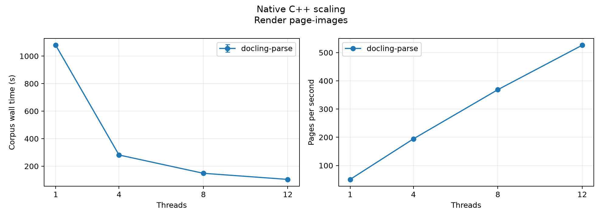

#### Speedup and parallel efficiency

Each profile uses its own one-thread result. Dashed lines show ideal speedup and 100% efficiency.

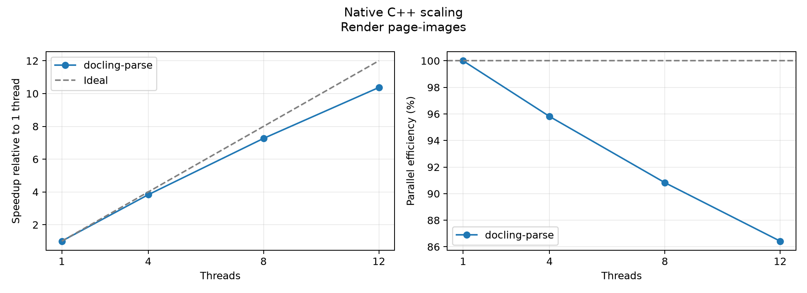

#### Where the native time goes

Stacked bars sum page worker elapsed by stage. Workers overlap: the stacked total is neither corpus wall time nor CPU time. Internal waits are included in worker elapsed.


#### Page worker-duration distribution

Page worker durations on logarithmic axes show the long tail and how it changes with thread count. These are not end-to-end page latencies or document wall times.

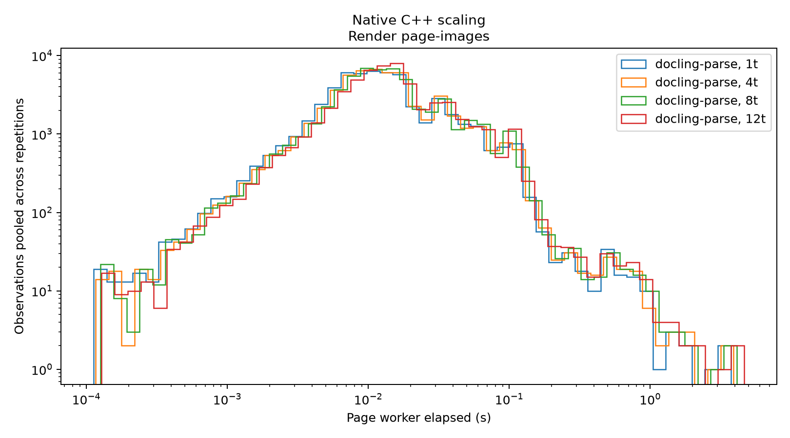

<details>
<summary>Reproduce the measurements for these figures</summary>

Run from the repository root after building. Set `PDF_ROOT` to the pinned corpus directory. Each invocation below runs in a fresh process and writes to a new output directory.

```bash
set -euo pipefail
PDF_ROOT=/path/to/performance-dataset-bo767/pdf
REPRO_OUT=$(mktemp -d "$PWD/scratch-performance-reproduce-XXXXXX")
for ((r=1; r<=1; r++)); do
  for t in 1 4 8 12; do
    ./build/run_scaling.exe "$PDF_ROOT" -v WARNING --recursive --mode render \
      --threads "$t" --max-concurrent-results 32 --scale 1.0 \
      --create-word-cells=false --create-line-cells=false \
      --enable-timing --timing-csv "$REPRO_OUT/r${r}-t${t}.csv" \
      2>&1 | tee "$REPRO_OUT/r${r}-t${t}.log"
  done
done
```

</details>

### Page-images and word/line text geometry

#### Wall time and throughput

Corpus wall time and pages per second. Document loading is excluded. The single observations do not provide a variability estimate.

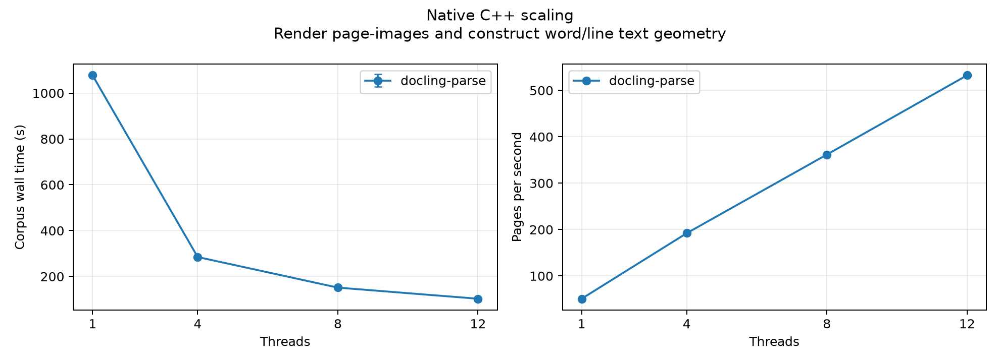

#### Speedup and parallel efficiency

Each profile uses its own one-thread result. Dashed lines show ideal speedup and 100% efficiency.

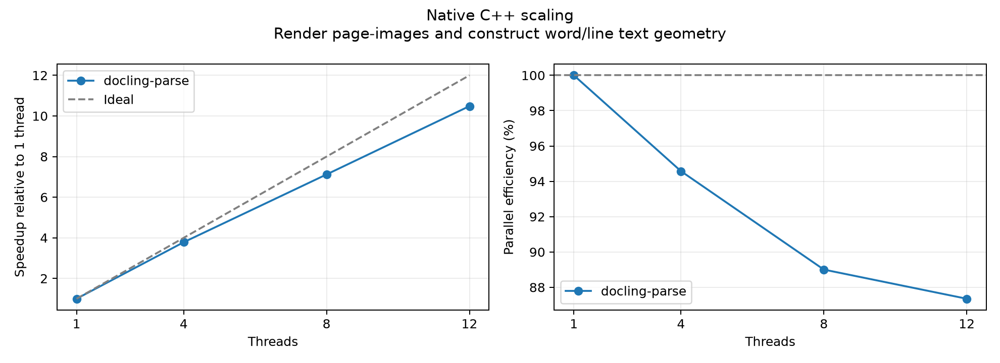

#### Where the native time goes

Stacked bars sum page worker elapsed by stage. Workers overlap: the stacked total is neither corpus wall time nor CPU time. Internal waits are included in worker elapsed.

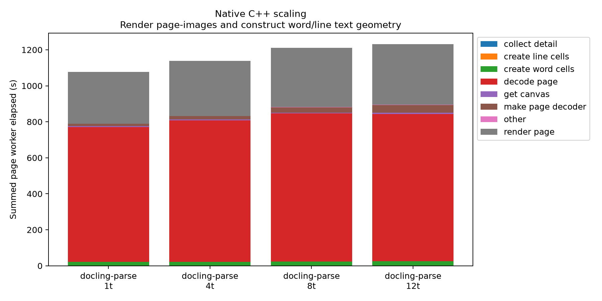

#### Page worker-duration distribution

Page worker durations on logarithmic axes show the long tail and how it changes with thread count. These are not end-to-end page latencies or document wall times.

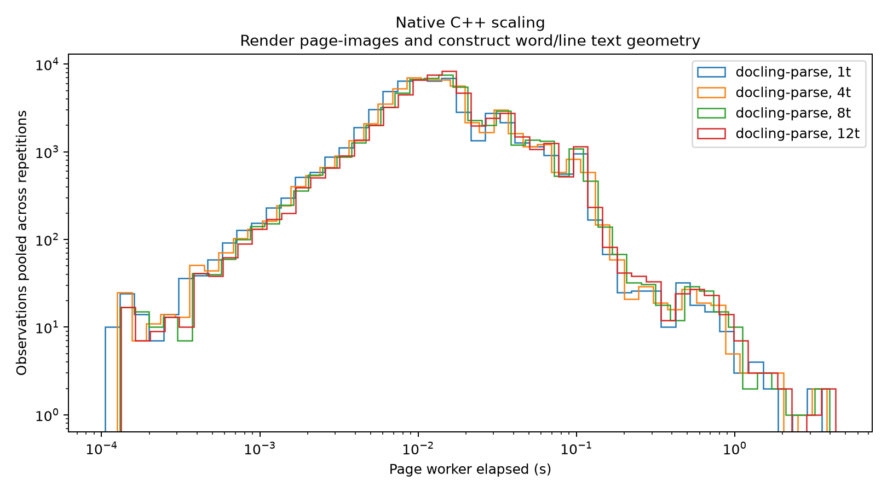

<details>
<summary>Reproduce the measurements for these figures</summary>

Run from the repository root after building. Set `PDF_ROOT` to the pinned corpus directory. Each invocation below runs in a fresh process and writes to a new output directory.

```bash
set -euo pipefail
PDF_ROOT=/path/to/performance-dataset-bo767/pdf
REPRO_OUT=$(mktemp -d "$PWD/scratch-performance-reproduce-XXXXXX")
for ((r=1; r<=1; r++)); do
  for t in 1 4 8 12; do
    ./build/run_scaling.exe "$PDF_ROOT" -v WARNING --recursive --mode render \
      --threads "$t" --max-concurrent-results 32 --scale 1.0 \
      --create-word-cells=true --create-line-cells=true \
      --enable-timing --timing-csv "$REPRO_OUT/r${r}-t${t}.csv" \
      2>&1 | tee "$REPRO_OUT/r${r}-t${t}.log"
  done
done
```

</details>

## Understanding the two Python experiments

**These sections measure different workloads and Python output representations.** They share a corpus, but their pages/second values cannot be subtracted to measure isolated Python overhead or interpreted as a change in native renderer performance. Neither experiment runs OCR, model inference or complete document conversion.

### What each experiment measures

The Docling-settings replay uses `run_performance_benchmarking_with_docling_settings.py` to replay selected backend operations from a pinned Docling revision, including adapter processing. The cross-package experiment uses `run_performance_benchmarking.py` to exercise each package's supported extraction API, optionally followed by rendering. It does not construct a common Docling output model across packages.

| Aspect | Python scaling with Docling settings | Python cross-package comparison |
|---|---|---|
| PDFium page-image generation | Render at 1.5 times the requested scale, copy the PIL image, then resize to the requested dimensions | Render directly at the requested scale and obtain a PIL image |
| PDFium text processing | Read character data, select text geometrically, normalize coordinates, merge fragmented cells and construct segmented-page models | Iterate PDFium text rectangles and call `get_text_bounded()`; no Docling page models or cell-merging adapter |
| Docling text output | Compute characters internally; materialize word and line models, without character models | Materialize character models; word/line construction is disabled |
| Docling page-image output | Obtain the rendered page-image and convert it to RGB | Obtain the rendered image without the replay's explicit RGB conversion |
| Additional geometry | Query separator lines, connected shapes and bitmap bounds | These adapter queries and separate bitmap-bound outputs are omitted |
| Docling document scheduling | Construct a parser, load, process and unload one document at a time; native page work within that document is threaded | Construct one parser and submit all documents before consuming results; native work can overlap submission |
| Native-memory release policy | Every 128 pages | No periodic release (`0`) |
| Reported wall time | Sum of document timers, including parser construction, loading, processing and unloading | Corpus timer including document loading and result consumption; parser construction occurs before this timer |
| Timed bookkeeping | Per-page metadata generation, JSONL writes and progress updates | Per-page timing collection and progress updates; checkpoint and final CSV writes occur after measurement |

Repeated image and segmented-page requests in the replay check caching; they do not repeat the underlying work. Both render profiles decode the image content needed to draw a page, even when exporting bitmap bytes or bitmap bounding-box models is disabled.

Text geometry is also different **within** the cross-package experiment: docling-parse materializes character cells; PDFium returns text rectangles; PyMuPDF returns `rawdict` character data; pdfplumber exposes `page.chars`; pdfminer.six walks `LTChar` objects; and pypdf's visitor exposes text-chunk positions. Its speedups compare these selected API workloads, not identical output granularity or extraction quality.

### Reading this run's throughput

Compare the replay with the cross-package **render** rows. Cross-package parse-only rows do not generate page-images. The table below pairs successful render measurements for the same package version and thread count; it does not assert equivalent workloads.

| Backend | Version | Threads | Docling-settings replay, pages/s | Cross-package text + render, pages/s |
|---|---|---:|---:|---:|
| pypdfium2 | 5.14.0 | 1 | 36.9 | 95.8 |
| docling-parse | 7.24.2 | 1 | 49.7 | 42.5 |
| docling-parse | 7.24.2 | 4 | 151.3 | 63.4 |
| docling-parse | 7.24.2 | 8 | 201.4 | 65.3 |
| docling-parse | 7.24.2 | 12 | 220.0 | 64.9 |

For PDFium, the replay performs additional text adaptation, geometry queries, model construction and image processing. Its intermediate image has approximately **2.25 times as many pixels** before resizing. These are verified workload differences; the measurements do not isolate their individual contributions to the timing gap.

For Docling, the replay requests additional adapter operations but avoids constructing a Python model for every character. It instead materializes word and line models. The cross-package character-model construction runs through the Python result consumer; adding native workers does not parallelize that Python construction loop. Character-level output therefore introduces a possible consumer bottleneck, even though this profile omits several replay operations.

In this run, cross-package Docling parse-only throughput is 69.5 pages/s at one thread and 69.1 pages/s at 12 threads. These observations help assess scaling for the character-output workload.

**Bottleneck attribution remains an inference.** These runs do not separately time character materialization or queue stalls, so they cannot quantify how much of the gap comes from either. Document scheduling, memory policy and process/cache state also differ: the launcher uses a fresh process per replay profile/thread count, while each cross-package mode runs its references and Docling thread sweep in one process. Use each experiment's own one-thread baseline when interpreting speedup and parallel efficiency.

## Python scaling with Docling settings

This workload creates **RGB page-images and text**, consumes segmented text models, obtains bitmap bounding boxes and queries separator geometry. Docling computes characters internally but materializes word/line models; PDFium constructs merged textline cells using its adapter. The text segmentation and page-image pixels are not identical across the engines.

The standalone replay follows Docling revision `07154cdc82500058ad9377bac92beed3de820458`. It excludes OCR, layout/table inference and Docling framework construction; exact parity with the full Docling backend has not been independently established.

The reported wall time is the sum of document `total_s`, including per-document parser construction/loading, page processing, model and page-image consumption, JSONL metadata writes, progress updates and unloading. Imports, corpus verification and final report serialization are outside this boundary.

| Backend | Version | Threads | Wall time (s) | Pages/s | Speedup vs PDFium (1t) | Speedup vs Docling (1t) | Efficiency |
|---|---|---:|---:|---:|---:|---:|---:|
| pypdfium2 | 5.14.0 | 1 | 1485.068 | 36.9 | 1.00x | 0.74x | — |
| docling-parse | 7.24.2 | 1 | 1100.957 | 49.7 | 1.35x | 1.00x | 100.0% |
| docling-parse | 7.24.2 | 4 | 361.817 | 151.3 | 4.10x | 3.04x | 76.1% |
| docling-parse | 7.24.2 | 8 | 271.772 | 201.4 | 5.46x | 4.05x | 50.6% |
| docling-parse | 7.24.2 | 12 | 248.806 | 220.0 | 5.97x | 4.42x | 36.9% |

Docling reaches 220.0 pages/s at 12 threads: 4.42x its one-thread result and 5.97x the PDFium replay result. These speedups refer to this page-image-and-text workload. They should not be transferred to the cross-package API comparison below.

The replay constructs and uses a parser for one document at a time. Native page work within that document is threaded, but documents are processed serially. Across the full corpus, Docling construction/load totals stay near 32.5–32.9 seconds while page-processing time decreases. At 12 threads, construction/load accounts for about 13.1% of the measured total. This is a serial contribution in this harness, not a general statement about every Docling deployment.

| Docling threads | Construction/load (s) | Page processing (s) | Unload (s) | Total (s) |
|---:|---:|---:|---:|---:|
| 1 | 32.888 | 1067.594 | 0.474 | 1100.957 |
| 4 | 32.642 | 328.571 | 0.604 | 361.817 |
| 8 | 32.635 | 238.493 | 0.645 | 271.772 |
| 12 | 32.537 | 215.620 | 0.649 | 248.806 |

On this corpus, the Docling replay materializes 12,207,024 word cells and 2,304,136 line cells, without character models. The PDFium replay returns 3,126,124 merged textline cells. These counts describe different segmentation contracts and do not establish extraction accuracy.

### Page-images and text: figures

#### Page-image-and-text wall time and throughput

Backend totals include parser construction/load, page processing and unloading. PDFium is driven with one worker; Docling uses the thread sweep.

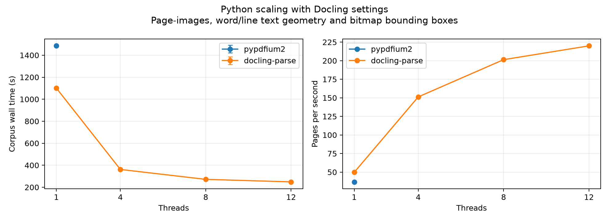

#### Python replay speedup and parallel efficiency

Docling speedup is relative to its own one-thread replay. The work includes Python output construction and a document-by-document lifecycle.

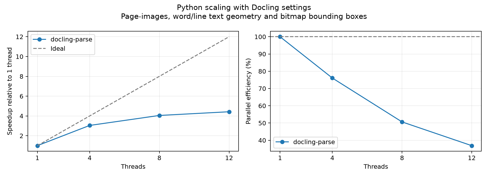

#### Document construction, processing and unloading

These are summed document phases, unlike the native worker-stage bars. Construction/load remains nearly constant while threaded page processing decreases.

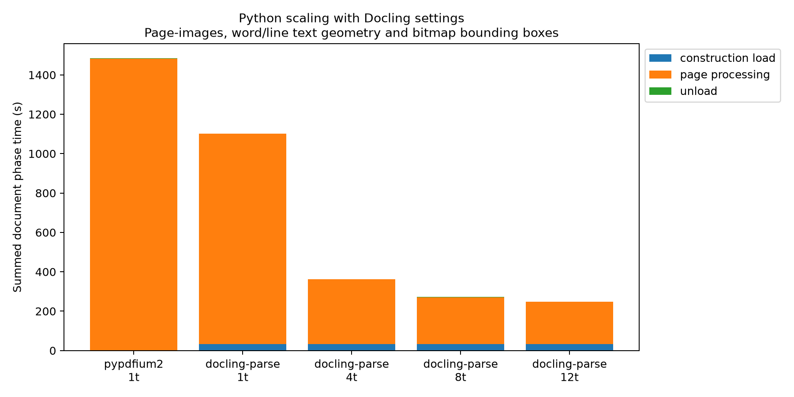

#### Whole-document duration distribution

Histograms pool document total times on logarithmic axes. Replay JSONL contains page output metadata, not individual page timings; it cannot supply per-page latency histograms.

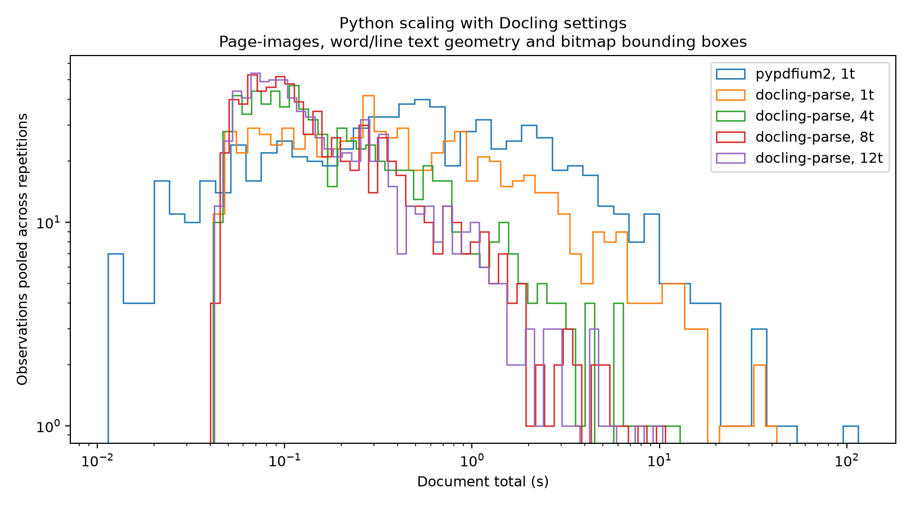

<details>
<summary>Reproduce the measurements for these figures</summary>

Run from the repository root after building. Set `PDF_ROOT` to the pinned corpus directory. Each invocation below runs in a fresh process and writes to a new output directory.

```bash
set -euo pipefail
PDF_ROOT=/path/to/performance-dataset-bo767/pdf
REPRO_OUT=$(mktemp -d "$PWD/scratch-performance-reproduce-XXXXXX")
for ((r=1; r<=1; r++)); do
  uv run --no-sync python scripts/benchmarking/run_performance_benchmarking_with_docling_settings.py "$PDF_ROOT" \
    --backend pdfium --dataset-revision 221c19e716d6ede5d18fd1560bc938ab19cc1a70 \
    --output-dir "$REPRO_OUT/r${r}-pdfium" 2>&1 | tee "$REPRO_OUT/r${r}-pdfium.log"
  for t in 1 4 8 12; do
    uv run --no-sync python scripts/benchmarking/run_performance_benchmarking_with_docling_settings.py "$PDF_ROOT" \
      --backend threaded --threads "$t" --dataset-revision 221c19e716d6ede5d18fd1560bc938ab19cc1a70 \
      --output-dir "$REPRO_OUT/r${r}-t${t}" 2>&1 | tee "$REPRO_OUT/r${r}-t${t}.log"
  done
done
```

</details>

## Python cross-package comparison

This experiment measures the selected public text/geometry APIs, optionally followed by rendering a page-image. It creates no shared Docling output representation for the reference packages. Docling materializes character models, with word/line construction and separate bitmap-bound models disabled. Reference packages are driven with one worker in this harness; Docling uses the requested native page-thread sweep.

The table and figures above explain why this workload differs from the Docling-settings replay. Its rates measure the chosen APIs and output granularity; they do not establish equal output fidelity or general limits on other packages' concurrency.

| Package | Text/geometry API | Page-image rendering API |
|---|---|---|
| docling-parse | Threaded parser with materialized character cells | Native renderer and `get_image()` |
| PyMuPDF | `get_text("rawdict")` character data | `get_pixmap()` and `pil_image()` |
| pypdfium2 | Text-page rectangles and bounded text | `page.render()` and `to_pil()` |
| pdfplumber | `page.chars` | `page.to_image()`, using PDFium |
| pdfminer.six | `extract_pages()` and an `LTChar` walk | Unsupported |
| pypdf | `extract_text(visitor_text=...)` text-chunk positions | Unsupported |

The corpus timer includes document loading and result consumption. Docling parser construction precedes the timer. Exact wall times come from completed-series checkpoints, whose provenance and CSV hashes are validated. Console rounding is checked for consistency; per-page worker timings and arrival gaps are not substituted for corpus wall time.

### Text and geometry, without page-images

| Backend | Version | Threads | Wall time (s) | Pages/s | Speedup vs PDFium (1t) | Speedup vs Docling (1t) | Efficiency |
|---|---|---:|---:|---:|---:|---:|---:|
| docling-parse | 7.24.2 | 1 | 787.445 | 69.5 | 0.25x | 1.00x | 100.0% |
| docling-parse | 7.24.2 | 4 | 776.090 | 70.5 | 0.25x | 1.01x | 25.4% |
| docling-parse | 7.24.2 | 8 | 784.243 | 69.8 | 0.25x | 1.00x | 12.6% |
| docling-parse | 7.24.2 | 12 | 792.253 | 69.1 | 0.24x | 0.99x | 8.3% |
| pdfminer.six | 20260107 | 1 | 1591.772 | 34.4 | 0.12x | 0.49x | — |
| pdfplumber | 0.11.10 | 1 | 1688.906 | 32.4 | 0.11x | 0.47x | — |
| pymupdf | 1.27.2.3 | 1 | 1422.534 | 38.5 | 0.14x | 0.55x | — |
| pypdfium2 | 5.14.0 | 1 | 193.079 | 283.5 | 1.00x | 4.08x | — |

#### Text/geometry API wall time and throughput

No page-images are created. Geometry varies from individual characters to rectangles or text chunks, depending on the package.

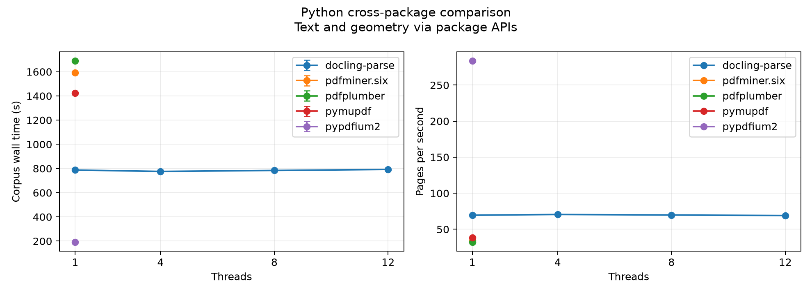

#### Character-model workload speedup and efficiency

The scalable series is Docling, relative to its one-thread API workload. The nearly flat throughput is consistent with a Python consumer bottleneck, but character materialization and queue stalls were not separately timed.

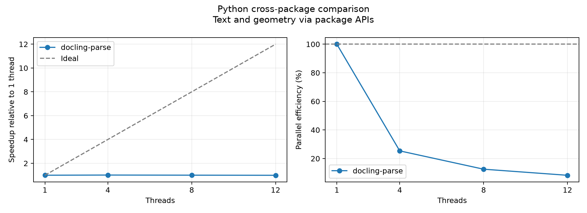

<details>
<summary>Reproduce the measurements for these figures</summary>

Run from the repository root after building. Set `PDF_ROOT` to the pinned corpus directory. Each invocation below runs in a fresh process and writes to a new output directory.

```bash
set -euo pipefail
PDF_ROOT=/path/to/performance-dataset-bo767/pdf
REPRO_OUT=$(mktemp -d "$PWD/scratch-performance-reproduce-XXXXXX")
for ((r=1; r<=1; r++)); do
  uv run --no-sync python scripts/benchmarking/run_performance_benchmarking.py "$PDF_ROOT" \
    --recursive --mode parse-without-bitmap --threads 1,4,8,12 --scale 1.0 --max-concurrent-results 32 \
    --3rd-party-backends all --only-threaded \
    --keep-char-cells=true --create-word-cells=false --create-line-cells=false \
    --keep-shapes=false --keep-bitmaps=false \
    --materialize-char-cells=true --materialize-word-cells=false \
    --materialize-line-cells=false --materialize-shapes=false --materialize-bitmaps=false \
    --output-dir "$REPRO_OUT/r${r}" 2>&1 | tee "$REPRO_OUT/r${r}.log"
done
```

</details>

### Page-images plus text and geometry

| Backend | Version | Threads | Wall time (s) | Pages/s | Speedup vs PDFium (1t) | Speedup vs Docling (1t) | Efficiency |
|---|---|---:|---:|---:|---:|---:|---:|
| docling-parse | 7.24.2 | 1 | 1287.637 | 42.5 | 0.44x | 1.00x | 100.0% |
| docling-parse | 7.24.2 | 4 | 863.604 | 63.4 | 0.66x | 1.49x | 37.3% |
| docling-parse | 7.24.2 | 8 | 838.376 | 65.3 | 0.68x | 1.54x | 19.2% |
| docling-parse | 7.24.2 | 12 | 842.685 | 64.9 | 0.68x | 1.53x | 12.7% |
| pdfplumber | 0.11.10 | 1 | 2309.746 | 23.7 | 0.25x | 0.56x | — |
| pymupdf | 1.27.2.3 | 1 | 1822.560 | 30.0 | 0.31x | 0.71x | — |
| pypdfium2 | 5.14.0 | 1 | 571.583 | 95.8 | 1.00x | 2.25x | — |

All seven successful rendering series cover 54,730 pages. Against PDFium, none differ in canvas size by more than two pixels; the largest observed delta is one pixel. Matching output dimensions do not establish pixel equivalence or equal rendering quality.

#### Page-image and text/geometry API wall time and throughput

This includes rendering at the requested scale plus each package's extraction API. PDFium does not perform the replay's 1.5-times-scale render, copy/resize or Docling model construction.

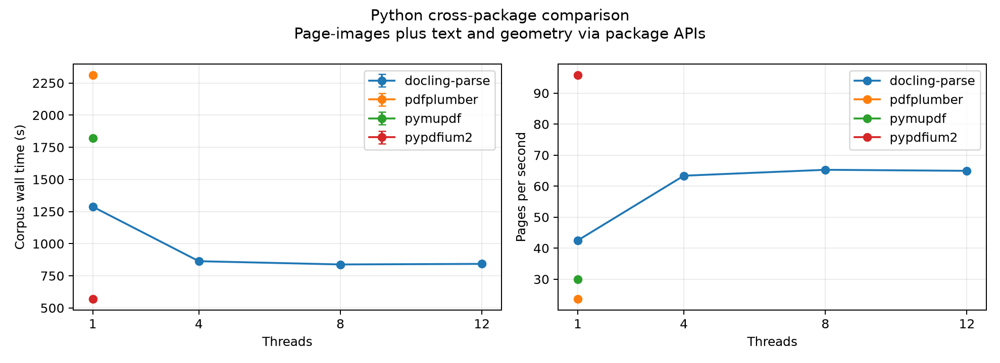

#### Page-image and character-model workload scaling

Docling scales from 42.5 to 64.9 pages/s at 12 threads, with 1.53x speedup. This is a different consumer/output workload from the 220.0 pages/s Docling-settings replay.

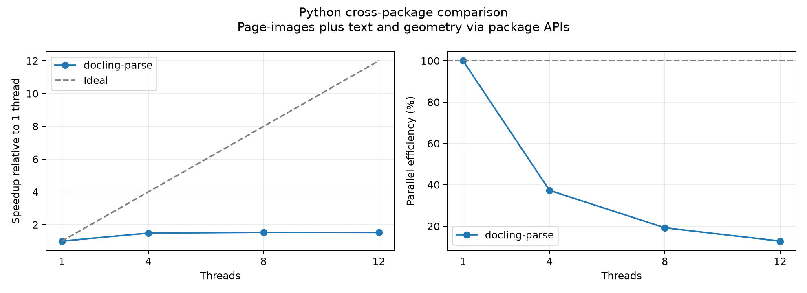

<details>
<summary>Reproduce the measurements for these figures</summary>

Run from the repository root after building. Set `PDF_ROOT` to the pinned corpus directory. Each invocation below runs in a fresh process and writes to a new output directory.

```bash
set -euo pipefail
PDF_ROOT=/path/to/performance-dataset-bo767/pdf
REPRO_OUT=$(mktemp -d "$PWD/scratch-performance-reproduce-XXXXXX")
for ((r=1; r<=1; r++)); do
  uv run --no-sync python scripts/benchmarking/run_performance_benchmarking.py "$PDF_ROOT" \
    --recursive --mode render --threads 1,4,8,12 --scale 1.0 --max-concurrent-results 32 \
    --3rd-party-backends all --only-threaded \
    --keep-char-cells=true --create-word-cells=false --create-line-cells=false \
    --keep-shapes=true --keep-bitmaps=true \
    --materialize-char-cells=true --materialize-word-cells=false \
    --materialize-line-cells=false --materialize-shapes=false --materialize-bitmaps=false \
    --output-dir "$REPRO_OUT/r${r}" 2>&1 | tee "$REPRO_OUT/r${r}.log"
done
```

</details>

### Reference failures and recovery

`pypdf 6.21.1` attempted all 54,730 pages but failed on 16, leaving 54,714 successful pages. Its series is excluded from performance tables, speedups and figures. The recorded failure cases are:

| Document | Pages (1-based) | Error |
|---|---|---|
| `1067588.pdf` | 191 | Maximum tokens per stream reached |
| `1106182.pdf` | 21 | Maximum tokens per stream reached |
| `1161467.pdf` | 20–22, 24–30 | Multiple `/FontFile` entries |
| `1245654.pdf` | 20 | Maximum tokens per stream reached |
| `2216123.pdf` | 55, 153, 162 | Maximum tokens per stream reached |

The original cross-package render run aborted in PyMuPDF 1.28.2 on Bo767 `1293644.pdf`, page 3. The reference was pinned to PyMuPDF 1.27.2.3, which rendered all 453 pages of that document. Recovery validated and reused the completed native/Python-replay measurements, then recollected both cross-package modes under separately recorded provenance. The failed original PyMuPDF run supplies no published performance result.

All 28 included corpus measurements completed without page failures. Full error details and raw checkpoints remain in the retained local bundles. A reference failure is reported separately only after every expected page was attempted; missing coverage, changed provenance/checksums and native failures still fail report validation.

## Provenance and scope

The compact [publication provenance](performance_benchmarks/2026-11-bo767-m3-max/provenance.json) records the dataset identity, build/extension hashes, source revisions and diff hashes, package versions, artifact hashes and original bundle identifiers. The local raw measurements remain in:

- Core measurements: `scratch-performance-refresh-20261106-132832-Ued2aI`.
- Completed comparison and report: `scratch-performance-recovery-c2rz8gq0`.

The core build recorded source revision `929a2b6ed7cc9648d9b9c3153362d6ee9542402a` plus its working-tree diff. Replay recorded `6dade98230ee60aaaa01a5db7111bda45382695d` after those changes were committed during the run. The commit patch exactly matches the recorded build diff, and the replay script hash matches that commit. Comparison provenance records `6dade98230ee60aaaa01a5db7111bda45382695d` plus its later diff. Recovery verified that the native binary, extension, core packages, Python and machine matched the original core run.

| Package | Version used |
|---|---|
| docling-parse | 7.24.2 |
| docling-core | 2.103.1 |
| pypdfium2 | 5.14.0 |
| Pillow | 12.3.0 |
| rtree | 1.4.1 |
| PyMuPDF, completed comparison | 1.27.2.3 |
| pdfplumber | 0.11.10 |
| pdfminer.six | 20260107 |
| pypdf, excluded reference | 6.21.1 |
| Matplotlib | 3.11.2 |

Build settings were CMake Release, `-O3 -DNDEBUG` and C++20, using `/usr/bin/c++` and the macOS SDK selected by `xcrun`. The native compiler version was not archived; Python reports Clang 20.1.4 as its own build compiler, which must not be substituted for the native compiler version.

The source bundles and full page-level CSV/JSONL data remain local. This documentation publishes the figures, tables and compact provenance rather than copying those data files into the repository. The figures total about 1.4 MB.

Throughput is pages divided by corpus wall time. Amortized milliseconds/page are `1000 * wall / pages`, not individual-page latency. Speedup is `wall(1) / wall(N)` within the same workload/backend/task; parallel efficiency is `100 * speedup / N`. With one repetition, a median equals the single observation and a min–max range provides no empirical variability information.

## Run the refresh

From the repository root, launch the native and Python page-image-and-text experiments:

```sh
bash scripts/benchmarking/refresh_performance_benchmarks.sh
```

To refresh every section of this page, including the slower cross-package suite,
and collect three repetitions:

```sh
REPEATS=3 RUN_COMPARISON=1 \
  bash scripts/benchmarking/refresh_performance_benchmarks.sh
```

These are full-corpus measurements and can take hours. The script installs the
build/dev/perf dependency groups, checks/builds the Python extension and standalone
executable incrementally, runs the damaged-page unit tests, resolves
the pinned snapshot, and records provenance before timing. It does not edit this
page or publish results.

`BUILD_MODE=incremental` is the default. Existing `build/` and `externals/`
directories are reused; CMake checks dependencies and recompiles affected
targets. Unchanged targets are reused. Cached repository, Python, SDK and
compiler paths are checked before and after dependency synchronization.
An incompatible cache stops the run and requests `BUILD_MODE=clean`.

Use `BUILD_MODE=clean` after SDK/toolchain changes or bundled dependency pin/patch
upgrades. Existing directories are then moved to `previous-build/` and
`previous-externals/` under the new output directory before rebuilding from
scratch. Build work remains outside all benchmark timers; each bundle records
the selected mode and native binary/extension hashes.
Setup stages and experiments are labeled by repetition, backend and thread
count. Runner output, including page progress bars, is streamed to the terminal
and saved in the run log. `BENCHMARK_OUTPUT=compact` is the launcher default:
repeated config tables and native timing tables are hidden, while progress and
result tables remain visible. Native timing summaries are saved beside each CSV
as `<timing-csv>.summary.log` and used by the report. Set
`BENCHMARK_OUTPUT=full` to print all benchmark tables. Standalone runners keep
their full output unless `--suppress-config` and, for C++, `--suppress-timings`
are requested. Completion messages report command elapsed time;
the report still uses each benchmark's own documented wall-time boundary.
On macOS, the launcher selects the current SDK with `xcrun`. A failed phase
prints its exit status, log path and final 40 log lines, then stops.

Each native thread profile and each replay backend/thread profile runs in its
own process. Runs execute sequentially. Each cross-package mode runs in one
process per repetition and measures its selected packages sequentially.

Run on an otherwise idle machine. Dataset verification reads the files before
measurement, so these are not cold-cache benchmarks. Repeat ranges expose
observed variation; they are not confidence intervals. Thread counts above the
machine's available physical/performance cores need separate interpretation.

Optional launcher settings:

```sh
# Small corpus for quick benchmark iterations; incremental build by default.
DATASET=bo20 THREADS=1,4 \
  bash scripts/benchmarking/refresh_performance_benchmarks.sh

# Shorter thread sweep; output directory must not already exist.
THREADS=1,4,8 REPEATS=1 OUT=scratch-performance-my-run \
  bash scripts/benchmarking/refresh_performance_benchmarks.sh

# Force a fresh build, for example after a bundled dependency upgrade.
BUILD_MODE=clean DATASET=bo20 \
  bash scripts/benchmarking/refresh_performance_benchmarks.sh

bash scripts/benchmarking/refresh_performance_benchmarks.sh --help
```

A successful launch prints the path to `report/summary.md`. Raw logs and page data
stay in that unique output directory. Inspect an active phase by tailing its log;
a nonzero exit stops the launcher and preserves completed measurements.

## Regenerate a report or recover a failed run

Regenerate the completed report without rebuilding or rerunning benchmarks:

```sh
uv run --no-sync python scripts/benchmarking/run_performance_report.py \
  scratch-performance-recovery-c2rz8gq0
```

A report-only run validates the saved measurements and regenerates tables and figures. Reference page failures are documented in its local `excluded_comparisons.csv` and `comparison_errors.csv`; the affected series is omitted from performance metrics across all repetitions. The published tables and figures are a reviewed snapshot, not automatically overwritten by the launcher.

For an interrupted benchmark, recover into a new bundle:

```sh
RECOVER_FROM=/absolute/path/to/scratch-performance-refresh-RUN \
  bash scripts/benchmarking/refresh_performance_benchmarks.sh
```

Recovery requires matching native binary/extension hashes, core packages, Python and machine, plus the original dataset hashes. It links the original native/replay artifacts, so keep the original bundle. It records comparison provenance separately and can reuse compatible completed checkpoints from an interrupted recovery. `BUILD_MODE=clean` is incompatible with recovery.

Reference-enabled refreshes preflight the known PyMuPDF page in a subprocess, when that PDF is present. Completed comparison series are checkpointed after their timers stop. If measurements finished and only reporting failed, use the report generator directly instead of rerunning recovery.

To inspect complete native/replay results while excluding comparisons:

```sh
uv run --no-sync python scripts/benchmarking/run_performance_report.py \
  /absolute/path/to/scratch-performance-refresh-RUN --core-only
```

This writes `report-core/`, explicitly labeling comparisons as excluded. See [the benchmarking tools README](../scripts/benchmarking/README.md) for detailed runner, output and recovery options. The older `run_performance_eval.py` uses arrival-gap-based scaling plots; use the report's corpus-wall-time figures for the comparisons on this page.

Performance measurements are separate from rendering or extraction quality: see [quality benchmarks](quality_benchmarks.md). Earlier measurements are retained in [legacy performance benchmarks](legacy/legacy_performance_benchmarks.md).
