<!-- performance:title:start -->
# Performance results: Bo20 / Apple M3 Max / 64 GiB / macOS
<!-- performance:title:end -->

[Methodology and all setups](../../../performance_benchmarks.md).

<!-- performance:setup:start -->
## Setup

Run: `scratch-performance-refresh-20261112-123829-Q21HfP`; collected 2026-11-12T12:38:29.

CPU: **Apple M3 Max**; architecture: arm64; RAM: 64 GiB; OS: macOS-26.6.2-arm64-arm-64bit.

Dataset: `docling-project/performance-dataset-bo20` at `65b9971b3fa939fe4ef89be678237e6928049b67`; 20 PDFs / 496 pages.

Repetitions: 3; threads: [1, 4, 8, 12]; render scale: 1.0; queue capacity: 32.

Values are medians with observed min-max ranges. One repetition provides no variability estimate. Speedup and efficiency use the same workload/task one-thread baseline.
<!-- performance:setup:end -->

<!-- performance:interpretation:start -->

<!-- performance:interpretation:end -->

<!-- performance:native:start -->
## Native C++ scaling

| Backend       | Version   | Task             | Threads   | Runs   | Wall median (s)   | Min-max (s)   | Pages/s   | Speedup vs Docling 1t   | Efficiency   |
|---------------|-----------|------------------|-----------|--------|-------------------|---------------|-----------|-------------------------|--------------|
| docling-parse | 7.25.0    | render-only      | 1         | 3      | 6.587             | 6.572-6.622   | 75.3      | 1.00x                   | 100.0%       |
| docling-parse | 7.25.0    | render-only      | 4         | 3      | 1.755             | 1.752-1.755   | 282.7     | 3.75x                   | 93.9%        |
| docling-parse | 7.25.0    | render-only      | 8         | 3      | 0.910             | 0.909-0.914   | 544.9     | 7.24x                   | 90.5%        |
| docling-parse | 7.25.0    | render-only      | 12        | 3      | 0.645             | 0.645-0.646   | 768.4     | 10.21x                  | 85.0%        |
| docling-parse | 7.25.0    | render-with-text | 1         | 3      | 6.719             | 6.715-6.789   | 73.8      | 1.00x                   | 100.0%       |
| docling-parse | 7.25.0    | render-with-text | 4         | 3      | 1.789             | 1.784-1.799   | 277.2     | 3.76x                   | 93.9%        |
| docling-parse | 7.25.0    | render-with-text | 8         | 3      | 0.930             | 0.926-0.931   | 533.6     | 7.23x                   | 90.4%        |
| docling-parse | 7.25.0    | render-with-text | 12        | 3      | 0.660             | 0.653-0.663   | 751.0     | 10.17x                  | 84.8%        |

### Render page-images

Timing: native wall_s; includes collection/CSV; excludes document preload.

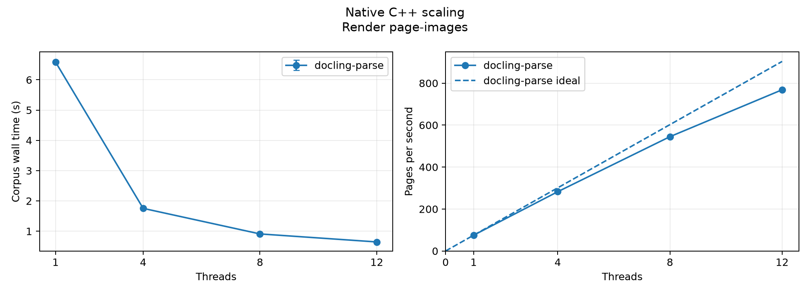

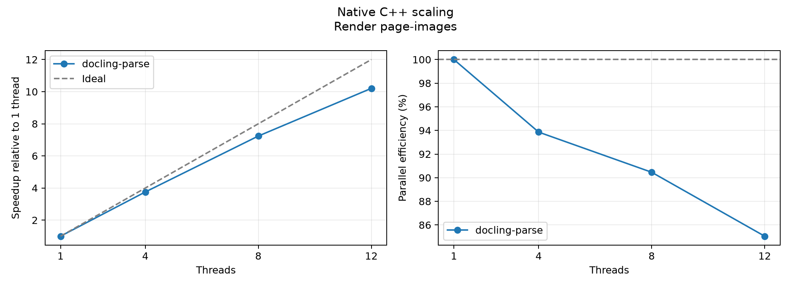

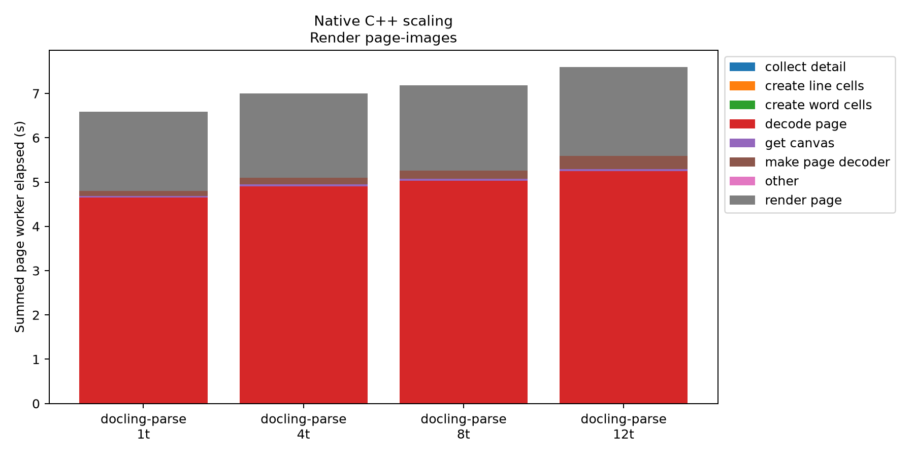

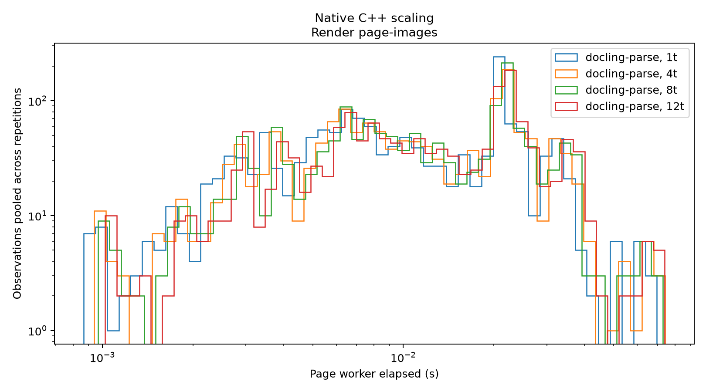

Stage totals sum overlapping worker elapsed time, not corpus wall or CPU time. Distributions describe native page-worker or replay document durations, not end-to-end page latency.

<details>
<summary>Reproduce these measurements</summary>

```bash
set -euo pipefail
PDF_ROOT=/Users/taa/.cache/huggingface/hub/datasets--docling-project--performance-dataset-bo20/snapshots/65b9971b3fa939fe4ef89be678237e6928049b67/pdf
REPRO_OUT=$(mktemp -d "$PWD/scratch-performance-reproduce-XXXXXX")
observe() {
  local memory_output=$1; shift
  .venv/bin/python scripts/benchmarking/_performance_memory.py --memory-mode profile --memory-interval-ms 50 \
    --output "${memory_output}.memory.json" -- "$@"
}
for ((r=1; r<=3; r++)); do
  for t in 1 4 8 12; do
    observe "$REPRO_OUT/r${r}-t${t}" ./build/run_scaling.exe "$PDF_ROOT" -v WARNING --recursive --mode render \
      --threads "$t" --max-concurrent-results 32 --scale 1.0 \
      --create-word-cells=false --create-line-cells=false \
      --enable-timing --timing-csv "$REPRO_OUT/r${r}-t${t}.csv" \
      2>&1 | tee "$REPRO_OUT/r${r}-t${t}.log"
  done
done
```

</details>

### Render page-images and construct word/line text geometry

Timing: native wall_s; includes collection/CSV; excludes document preload.

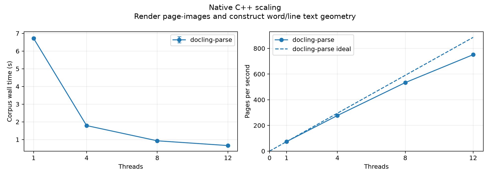

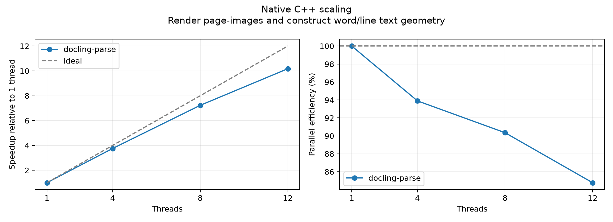

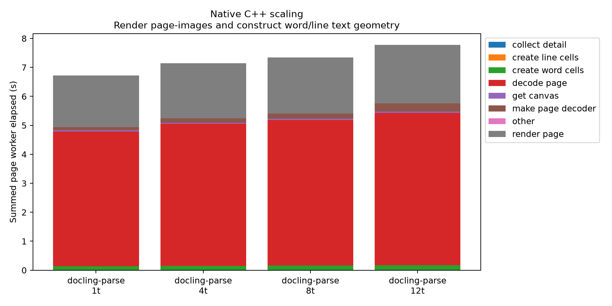

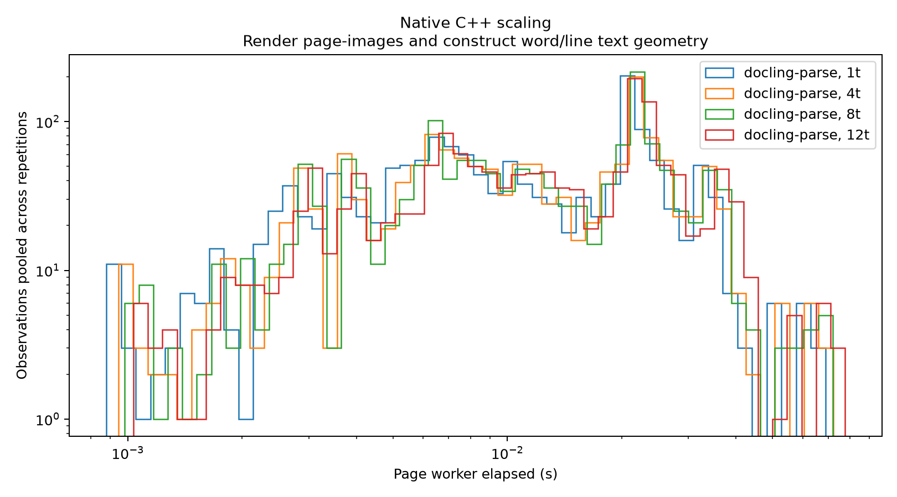

Stage totals sum overlapping worker elapsed time, not corpus wall or CPU time. Distributions describe native page-worker or replay document durations, not end-to-end page latency.

<details>
<summary>Reproduce these measurements</summary>

```bash
set -euo pipefail
PDF_ROOT=/Users/taa/.cache/huggingface/hub/datasets--docling-project--performance-dataset-bo20/snapshots/65b9971b3fa939fe4ef89be678237e6928049b67/pdf
REPRO_OUT=$(mktemp -d "$PWD/scratch-performance-reproduce-XXXXXX")
observe() {
  local memory_output=$1; shift
  .venv/bin/python scripts/benchmarking/_performance_memory.py --memory-mode profile --memory-interval-ms 50 \
    --output "${memory_output}.memory.json" -- "$@"
}
for ((r=1; r<=3; r++)); do
  for t in 1 4 8 12; do
    observe "$REPRO_OUT/r${r}-t${t}" ./build/run_scaling.exe "$PDF_ROOT" -v WARNING --recursive --mode render \
      --threads "$t" --max-concurrent-results 32 --scale 1.0 \
      --create-word-cells=true --create-line-cells=true \
      --enable-timing --timing-csv "$REPRO_OUT/r${r}-t${t}.csv" \
      2>&1 | tee "$REPRO_OUT/r${r}-t${t}.log"
  done
done
```

</details>
<!-- performance:native:end -->

<!-- performance:replay:start -->
## Python scaling with Docling settings

| Backend       | Version   | Task   | Threads   | Runs   | Wall median (s)   | Min-max (s)   | Pages/s   | Speedup vs Docling 1t   | Efficiency   |
|---------------|-----------|--------|-----------|--------|-------------------|---------------|-----------|-------------------------|--------------|
| pypdfium2     | 5.14.0    | render | 1         | 3      | 11.815            | 11.755-11.916 | 42.0      | 0.66x                   | —            |
| docling-parse | 7.25.0    | render | 1         | 3      | 7.806             | 7.758-7.825   | 63.5      | 1.00x                   | 100.0%       |
| docling-parse | 7.25.0    | render | 4         | 3      | 3.058             | 3.011-3.067   | 162.2     | 2.55x                   | 63.8%        |
| docling-parse | 7.25.0    | render | 8         | 3      | 2.299             | 2.281-2.314   | 215.7     | 3.40x                   | 42.4%        |
| docling-parse | 7.25.0    | render | 12        | 3      | 2.173             | 2.159-2.221   | 228.3     | 3.59x                   | 29.9%        |

### Page-images, word/line text geometry and bitmap bounding boxes

Timing: sum of document total_s; includes construction/load, processing and unload.

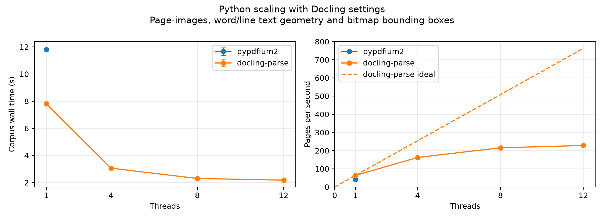

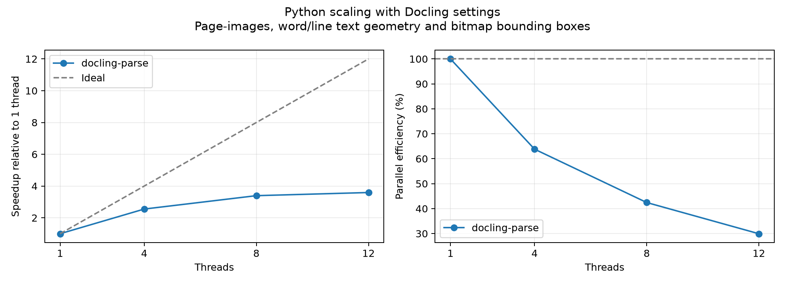

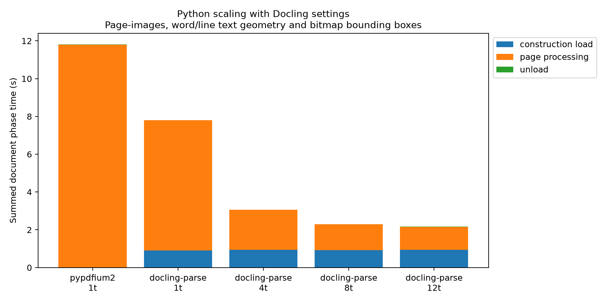

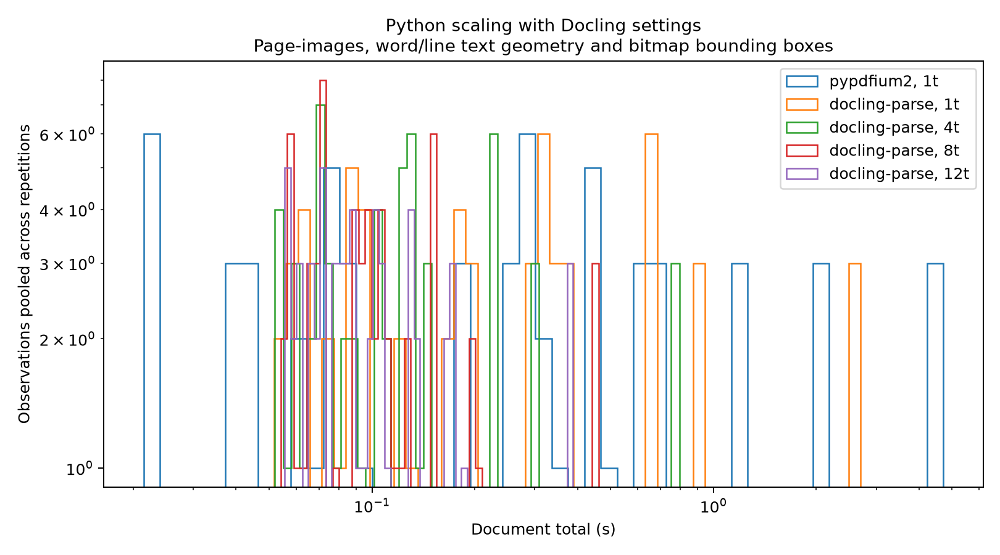

Stage totals sum overlapping worker elapsed time, not corpus wall or CPU time. Distributions describe native page-worker or replay document durations, not end-to-end page latency.

<details>
<summary>Reproduce these measurements</summary>

```bash
set -euo pipefail
PDF_ROOT=/Users/taa/.cache/huggingface/hub/datasets--docling-project--performance-dataset-bo20/snapshots/65b9971b3fa939fe4ef89be678237e6928049b67/pdf
REPRO_OUT=$(mktemp -d "$PWD/scratch-performance-reproduce-XXXXXX")
observe() {
  local memory_output=$1; shift
  .venv/bin/python scripts/benchmarking/_performance_memory.py --memory-mode profile --memory-interval-ms 50 \
    --output "${memory_output}.memory.json" -- "$@"
}
for ((r=1; r<=3; r++)); do
  observe "$REPRO_OUT/r${r}-pdfium" .venv/bin/python scripts/benchmarking/run_performance_benchmarking_with_docling_settings.py "$PDF_ROOT" \
    --backend pdfium --dataset-revision 65b9971b3fa939fe4ef89be678237e6928049b67 \
    --output-dir "$REPRO_OUT/r${r}-pdfium" 2>&1 | tee "$REPRO_OUT/r${r}-pdfium.log"
  for t in 1 4 8 12; do
    observe "$REPRO_OUT/r${r}-t${t}" .venv/bin/python scripts/benchmarking/run_performance_benchmarking_with_docling_settings.py "$PDF_ROOT" \
      --backend threaded --threads "$t" --dataset-revision 65b9971b3fa939fe4ef89be678237e6928049b67 \
      --output-dir "$REPRO_OUT/r${r}-t${t}" 2>&1 | tee "$REPRO_OUT/r${r}-t${t}.log"
  done
done
```

</details>
<!-- performance:replay:end -->

<!-- performance:comparison:start -->
## Python cross-package comparison

Not collected in this run.
<!-- performance:comparison:end -->

<!-- performance:memory:start -->
## Process Memory

OS high-water marks cover one backend process and all its threads, including startup, loading and teardown. They exclude the monitor/logger and are not parser-only heap sizes. Timing retains each workload's existing boundaries. Missing observations are unavailable, never zero.

| Workload   | Backend       | Task             | Threads   | Peaks/runs   | Median MiB   | Min MiB   | Largest peak MiB   | Capture   |
|------------|---------------|------------------|-----------|--------------|--------------|-----------|--------------------|-----------|
| native     | docling-parse | render-only      | 1         | 3/3          | 543.78       | 541.97    | 545.81             | profile   |
| native     | docling-parse | render-only      | 4         | 3/3          | 734.17       | 727.98    | 756.83             | profile   |
| native     | docling-parse | render-only      | 8         | 3/3          | 913.77       | 912.28    | 918.95             | profile   |
| native     | docling-parse | render-only      | 12        | 3/3          | 1034.33      | 1008.66   | 1044.36            | profile   |
| native     | docling-parse | render-with-text | 1         | 3/3          | 546.31       | 545.61    | 548.48             | profile   |
| native     | docling-parse | render-with-text | 4         | 3/3          | 744.83       | 729.03    | 751.19             | profile   |
| native     | docling-parse | render-with-text | 8         | 3/3          | 909.89       | 888.56    | 929.27             | profile   |
| native     | docling-parse | render-with-text | 12        | 3/3          | 1037.03      | 1034.78   | 1057.19            | profile   |
| replay     | pdfium        | render           | 1         | 3/3          | 626.72       | 623.80    | 631.19             | profile   |
| replay     | threaded      | render           | 1         | 3/3          | 700.47       | 680.89    | 704.22             | profile   |
| replay     | threaded      | render           | 4         | 3/3          | 844.12       | 834.98    | 845.12             | profile   |
| replay     | threaded      | render           | 8         | 3/3          | 1008.50      | 996.47    | 1040.77            | profile   |
| replay     | threaded      | render           | 12        | 3/3          | 1169.38      | 1152.45   | 1171.09            | profile   |

`existing` denotes a previously recorded replay RUSAGE_SELF peak. Reused runs have no new timeline. Peak/profile comparison series run in fresh processes; memory-off comparisons retain their historical shared-process execution. Compare timing only under matching instrumentation and isolation. Sampled maxima are separate from OS peaks and can miss short spikes. Methods and scopes are recorded in publication provenance.


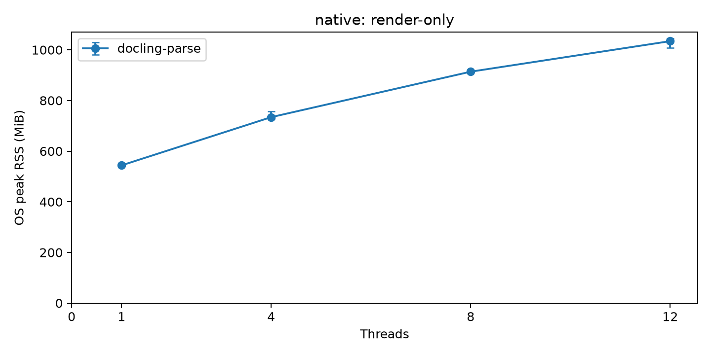

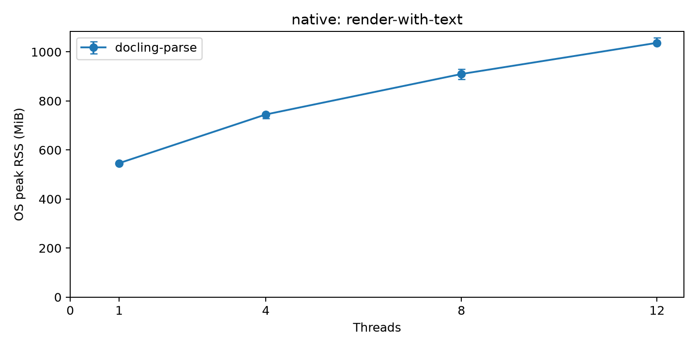

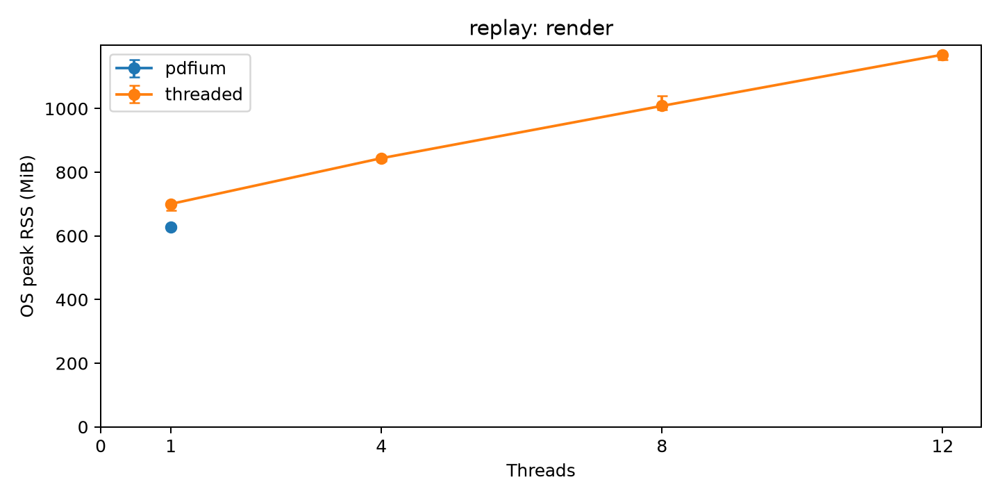
<!-- performance:memory:end -->

<!-- performance:provenance:start -->
## Provenance

[Dataset, source, build, packages and memory methods](provenance.json). Raw measurements and detailed RSS timelines remain in the local run bundle.
<!-- performance:provenance:end -->
