<!-- performance:title:start -->
# Performance results: Bo767 / amd-ryzen-7-9800x3d-8-core-processor / unknown RAM / Linux
<!-- performance:title:end -->

[Methodology and all setups](../../../performance_benchmarks.md).

<!-- performance:setup:start -->
## Setup

Run: `scratch-performance-refresh-20261119-114423-ofpV75`; collected 2026-11-19T11:44:23.

CPU: **unknown**; architecture: x86_64; RAM: unknown RAM; OS: Linux-7.2.15-100.fc43.x86_64-x86_64-with-glibc2.42.

Dataset: `docling-project/performance-dataset-bo767` at `221c19e716d6ede5d18fd1560bc938ab19cc1a70`; 767 PDFs / 54,730 pages.

Repetitions: 1; threads: [1, 4, 8, 12]; render scale: 1.0; queue capacity: 32.

Values are medians with observed min-max ranges. One repetition provides no variability estimate. Speedup and efficiency use the lowest measured Docling thread count for each workload and task.
<!-- performance:setup:end -->

<!-- performance:interpretation:start -->

<!-- performance:interpretation:end -->

<!-- performance:native:start -->
## Native C++ scaling

| Backend       | Version   | Task             | Threads   | Runs   | Wall median (s)   | Min-max (s)       | Pages/s   | Speedup vs Docling baseline   | Efficiency   |
|---------------|-----------|------------------|-----------|--------|-------------------|-------------------|-----------|-------------------------------|--------------|
| docling-parse | 7.26.0    | render-only      | 1         | 1      | 1134.095          | 1134.095-1134.095 | 48.3      | 1.00x (1t)                    | 100.0%       |
| docling-parse | 7.26.0    | render-only      | 4         | 1      | 278.146           | 278.146-278.146   | 196.8     | 4.08x (1t)                    | 101.9%       |
| docling-parse | 7.26.0    | render-only      | 8         | 1      | 152.965           | 152.965-152.965   | 357.8     | 7.41x (1t)                    | 92.7%        |
| docling-parse | 7.26.0    | render-only      | 12        | 1      | 134.121           | 134.121-134.121   | 408.1     | 8.46x (1t)                    | 70.5%        |
| docling-parse | 7.26.0    | render-with-text | 1         | 1      | 1134.197          | 1134.197-1134.197 | 48.3      | 1.00x (1t)                    | 100.0%       |
| docling-parse | 7.26.0    | render-with-text | 4         | 1      | 339.160           | 339.160-339.160   | 161.4     | 3.34x (1t)                    | 83.6%        |
| docling-parse | 7.26.0    | render-with-text | 8         | 1      | 160.707           | 160.707-160.707   | 340.6     | 7.06x (1t)                    | 88.2%        |
| docling-parse | 7.26.0    | render-with-text | 12        | 1      | 139.149           | 139.149-139.149   | 393.3     | 8.15x (1t)                    | 67.9%        |

### Render page-images

Timing: native wall_s; includes collection/CSV; excludes document preload.

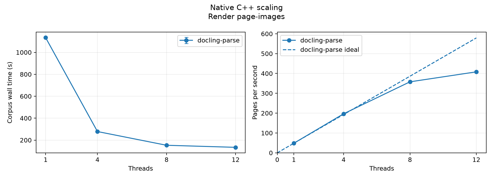

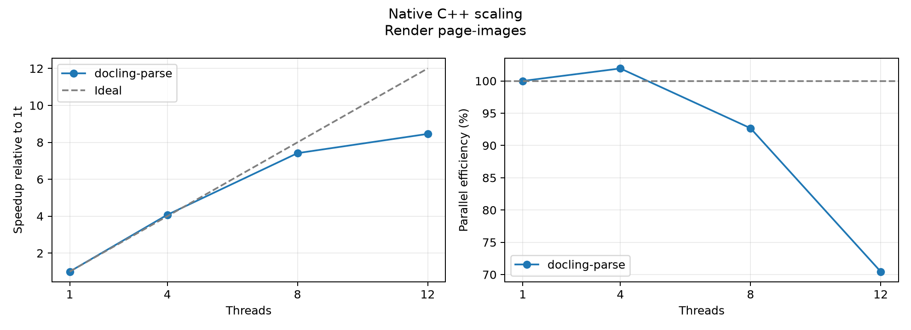

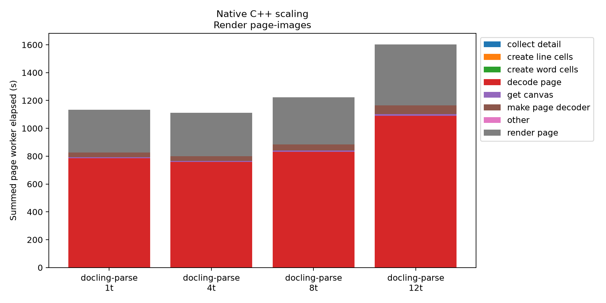

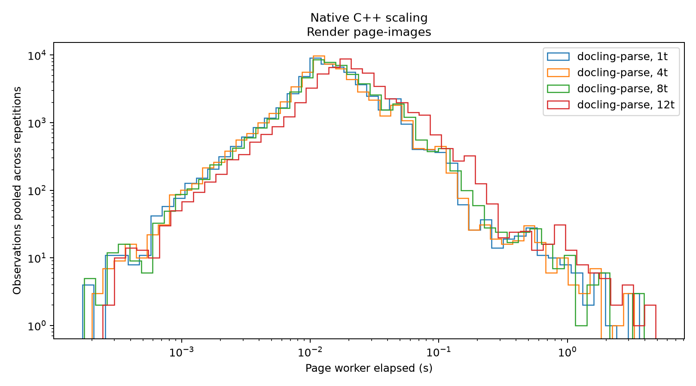

Stage totals sum overlapping worker elapsed time, not corpus wall or CPU time. Distributions describe native page-worker or replay document durations, not end-to-end page latency.

<details>
<summary>Reproduce these measurements</summary>

```bash
set -euo pipefail
PDF_ROOT=/home/taa/.cache/huggingface/hub/datasets--docling-project--performance-dataset-bo767/snapshots/221c19e716d6ede5d18fd1560bc938ab19cc1a70/pdf
REPRO_OUT=$(mktemp -d "$PWD/scratch-performance-reproduce-XXXXXX")
for ((r=1; r<=1; r++)); do
  for t in 1 4 8 12; do
    ./build/run_scaling.exe "$PDF_ROOT" -v WARNING --recursive --mode render \
      --threads "$t" --max-concurrent-results 32 --scale 1.0 \
      --create-word-cells=false --create-line-cells=false \
      --enable-timing --timing-csv "$REPRO_OUT/r${r}-t${t}.csv" \
      2>&1 | tee "$REPRO_OUT/r${r}-t${t}.log"
  done
done
```

</details>

### Render page-images and construct word/line text geometry

Timing: native wall_s; includes collection/CSV; excludes document preload.

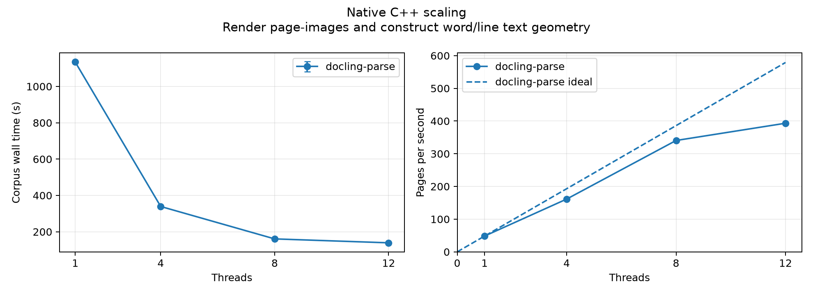

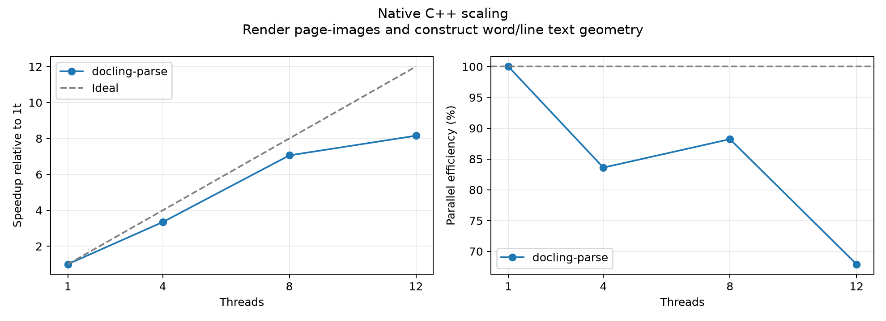

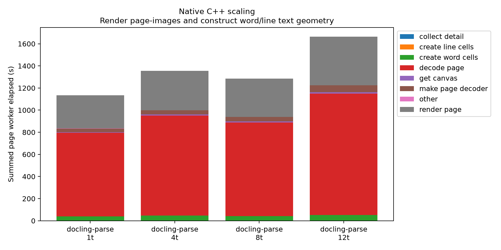

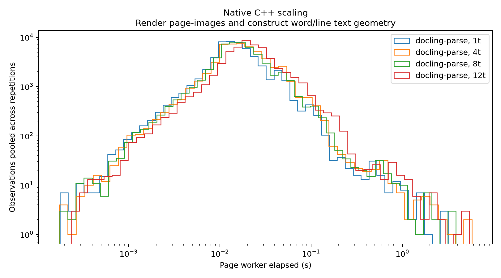

Stage totals sum overlapping worker elapsed time, not corpus wall or CPU time. Distributions describe native page-worker or replay document durations, not end-to-end page latency.

<details>
<summary>Reproduce these measurements</summary>

```bash
set -euo pipefail
PDF_ROOT=/home/taa/.cache/huggingface/hub/datasets--docling-project--performance-dataset-bo767/snapshots/221c19e716d6ede5d18fd1560bc938ab19cc1a70/pdf
REPRO_OUT=$(mktemp -d "$PWD/scratch-performance-reproduce-XXXXXX")
for ((r=1; r<=1; r++)); do
  for t in 1 4 8 12; do
    ./build/run_scaling.exe "$PDF_ROOT" -v WARNING --recursive --mode render \
      --threads "$t" --max-concurrent-results 32 --scale 1.0 \
      --create-word-cells=true --create-line-cells=true \
      --enable-timing --timing-csv "$REPRO_OUT/r${r}-t${t}.csv" \
      2>&1 | tee "$REPRO_OUT/r${r}-t${t}.log"
  done
done
```

</details>
<!-- performance:native:end -->

<!-- performance:replay:start -->
## Python scaling with Docling settings

| Backend       | Version   | Task   | Threads   | Runs   | Wall median (s)   | Min-max (s)       | Pages/s   | Speedup vs Docling baseline   | Efficiency   |
|---------------|-----------|--------|-----------|--------|-------------------|-------------------|-----------|-------------------------------|--------------|
| pypdfium2     | 5.14.0    | render | 1         | 1      | 1504.961          | 1504.961-1504.961 | 36.4      | 0.74x (1t)                    | —            |
| docling-parse | 7.26.0    | render | 1         | 1      | 1117.532          | 1117.532-1117.532 | 49.0      | 1.00x (1t)                    | 100.0%       |
| docling-parse | 7.26.0    | render | 4         | 1      | 338.519           | 338.519-338.519   | 161.7     | 3.30x (1t)                    | 82.5%        |
| docling-parse | 7.26.0    | render | 8         | 1      | 290.332           | 290.332-290.332   | 188.5     | 3.85x (1t)                    | 48.1%        |
| docling-parse | 7.26.0    | render | 12        | 1      | 280.552           | 280.552-280.552   | 195.1     | 3.98x (1t)                    | 33.2%        |

### Page-images, word/line text geometry and bitmap bounding boxes

Timing: sum of document total_s; includes construction/load, processing and unload.

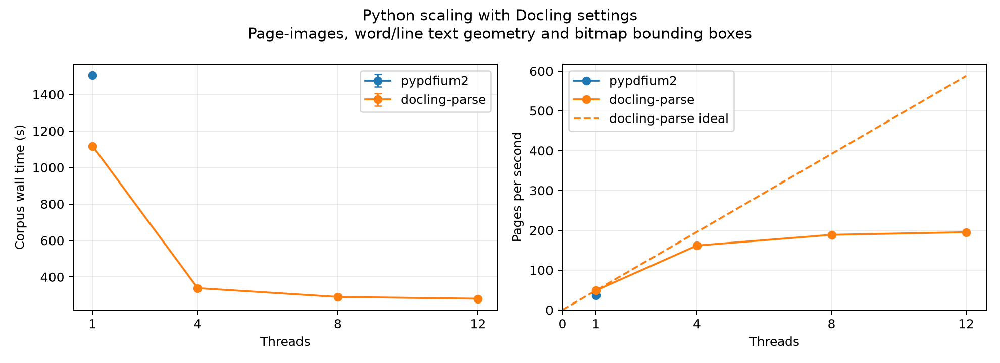

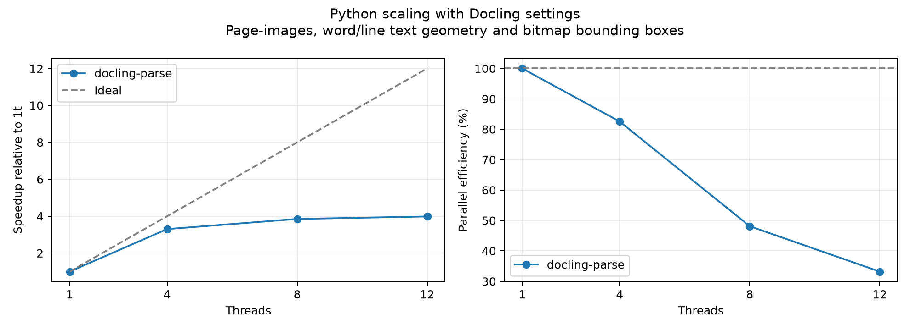

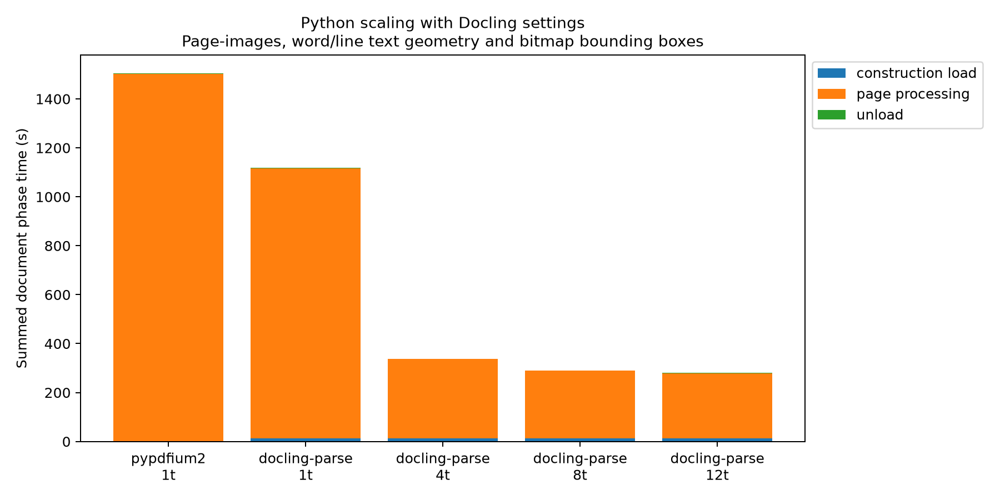

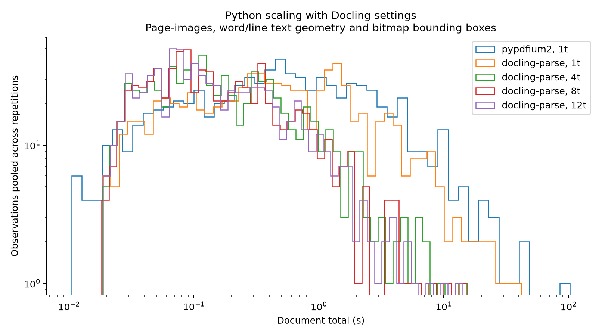

Stage totals sum overlapping worker elapsed time, not corpus wall or CPU time. Distributions describe native page-worker or replay document durations, not end-to-end page latency.

<details>
<summary>Reproduce these measurements</summary>

```bash
set -euo pipefail
PDF_ROOT=/home/taa/.cache/huggingface/hub/datasets--docling-project--performance-dataset-bo767/snapshots/221c19e716d6ede5d18fd1560bc938ab19cc1a70/pdf
REPRO_OUT=$(mktemp -d "$PWD/scratch-performance-reproduce-XXXXXX")
for ((r=1; r<=1; r++)); do
  uv run --no-sync python scripts/benchmarking/run_performance_benchmarking_with_docling_settings.py "$PDF_ROOT" \
    --backend pdfium --dataset-revision 221c19e716d6ede5d18fd1560bc938ab19cc1a70 \
    --output-dir "$REPRO_OUT/r${r}-pdfium" 2>&1 | tee "$REPRO_OUT/r${r}-pdfium.log"
  for t in 1 4 8 12; do
    uv run --no-sync python scripts/benchmarking/run_performance_benchmarking_with_docling_settings.py "$PDF_ROOT" \
      --backend threaded --threads "$t" --dataset-revision 221c19e716d6ede5d18fd1560bc938ab19cc1a70 \
      --output-dir "$REPRO_OUT/r${r}-t${t}" 2>&1 | tee "$REPRO_OUT/r${r}-t${t}.log"
  done
done
```

</details>
<!-- performance:replay:end -->

<!-- performance:comparison:start -->
## Python cross-package comparison

Not collected in this run.
<!-- performance:comparison:end -->

<!-- performance:memory:start -->
## Process Memory

OS high-water marks cover one backend process and all its threads, including startup, loading and teardown. They exclude the monitor/logger and are not parser-only heap sizes. Timing retains each workload's existing boundaries. Missing observations are unavailable, never zero.

| Workload   | Backend       | Task             | Threads   | Peaks/runs   | Median MiB   | Min MiB     | Largest peak MiB   | Capture     |
|------------|---------------|------------------|-----------|--------------|--------------|-------------|--------------------|-------------|
| native     | docling-parse | render-only      | 1         | 0/1          | unavailable  | unavailable | unavailable        | unavailable |
| native     | docling-parse | render-only      | 4         | 0/1          | unavailable  | unavailable | unavailable        | unavailable |
| native     | docling-parse | render-only      | 8         | 0/1          | unavailable  | unavailable | unavailable        | unavailable |
| native     | docling-parse | render-only      | 12        | 0/1          | unavailable  | unavailable | unavailable        | unavailable |
| native     | docling-parse | render-with-text | 1         | 0/1          | unavailable  | unavailable | unavailable        | unavailable |
| native     | docling-parse | render-with-text | 4         | 0/1          | unavailable  | unavailable | unavailable        | unavailable |
| native     | docling-parse | render-with-text | 8         | 0/1          | unavailable  | unavailable | unavailable        | unavailable |
| native     | docling-parse | render-with-text | 12        | 0/1          | unavailable  | unavailable | unavailable        | unavailable |
| replay     | pdfium        | render           | 1         | 1/1          | 1225.29      | 1225.29     | 1225.29            | existing    |
| replay     | threaded      | render           | 1         | 1/1          | 3022.55      | 3022.55     | 3022.55            | existing    |
| replay     | threaded      | render           | 4         | 1/1          | 4863.61      | 4863.61     | 4863.61            | existing    |
| replay     | threaded      | render           | 8         | 1/1          | 4527.62      | 4527.62     | 4527.62            | existing    |
| replay     | threaded      | render           | 12        | 1/1          | 5571.59      | 5571.59     | 5571.59            | existing    |

`existing` denotes a previously recorded replay RUSAGE_SELF peak. Reused runs have no new timeline. Peak/profile comparison series run in fresh processes; memory-off comparisons retain their historical shared-process execution. Compare timing only under matching instrumentation and isolation. Sampled maxima are separate from OS peaks and can miss short spikes. Methods and scopes are recorded in publication provenance.


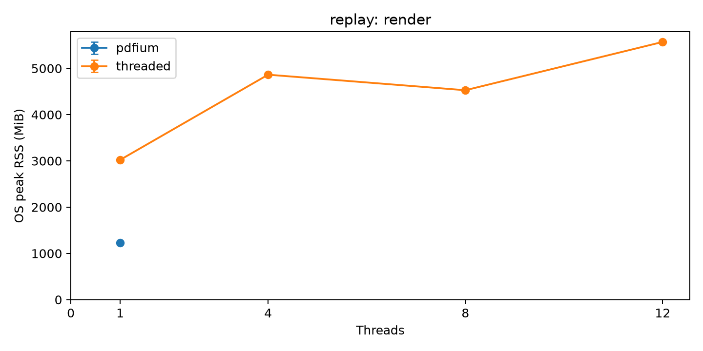
<!-- performance:memory:end -->

<!-- performance:provenance:start -->
## Provenance

[Dataset, source, build, packages and memory methods](provenance.json). Raw measurements and detailed RSS timelines remain in the local run bundle.
<!-- performance:provenance:end -->
