<!-- performance:title:start -->
# Performance results: Bo767 / Apple M3 Max / 64 GiB / macOS
<!-- performance:title:end -->

[Methodology and all setups](../../../performance_benchmarks.md).

<!-- performance:setup:start -->
## Setup

Run: `scratch-performance-recovery-8vumw3sy`; collected 2026-11-12T17:27:10.253402.

CPU: **Apple M3 Max**; architecture: arm64; RAM: 64 GiB; OS: macOS-26.6.2-arm64-arm-64bit.

Dataset: `docling-project/performance-dataset-bo767` at `221c19e716d6ede5d18fd1560bc938ab19cc1a70`; 767 PDFs / 54,730 pages.

Repetitions: 3; threads: [1, 4, 8, 12]; render scale: 1.0; queue capacity: 32.

Values are medians with observed min-max ranges. One repetition provides no variability estimate. Speedup and efficiency use the same workload/task one-thread baseline.
<!-- performance:setup:end -->

<!-- performance:interpretation:start -->

<!-- performance:interpretation:end -->

<!-- performance:native:start -->
## Native C++ scaling

| Backend       | Version   | Task             | Threads   | Runs   | Wall median (s)   | Min-max (s)       | Pages/s   | Speedup vs Docling 1t   | Efficiency   |
|---------------|-----------|------------------|-----------|--------|-------------------|-------------------|-----------|-------------------------|--------------|
| docling-parse | 7.25.0    | render-only      | 1         | 3      | 1071.194          | 1069.906-1101.857 | 51.1      | 1.00x                   | 100.0%       |
| docling-parse | 7.25.0    | render-only      | 4         | 3      | 283.046           | 283.023-287.826   | 193.4     | 3.78x                   | 94.6%        |
| docling-parse | 7.25.0    | render-only      | 8         | 3      | 149.237           | 148.032-149.848   | 366.7     | 7.18x                   | 89.7%        |
| docling-parse | 7.25.0    | render-only      | 12        | 3      | 102.384           | 101.552-104.521   | 534.6     | 10.46x                  | 87.2%        |
| docling-parse | 7.25.0    | render-with-text | 1         | 3      | 1101.388          | 1100.648-1115.716 | 49.7      | 1.00x                   | 100.0%       |
| docling-parse | 7.25.0    | render-with-text | 4         | 3      | 290.714           | 290.281-293.247   | 188.3     | 3.79x                   | 94.7%        |
| docling-parse | 7.25.0    | render-with-text | 8         | 3      | 153.550           | 151.612-154.036   | 356.4     | 7.17x                   | 89.7%        |
| docling-parse | 7.25.0    | render-with-text | 12        | 3      | 106.039           | 104.173-106.791   | 516.1     | 10.39x                  | 86.6%        |

### Render page-images

Timing: native wall_s; includes collection/CSV; excludes document preload.

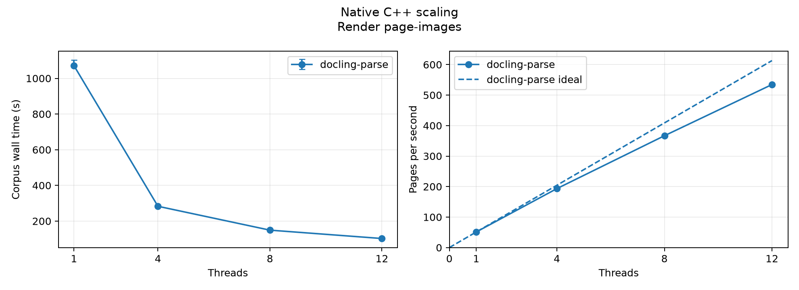

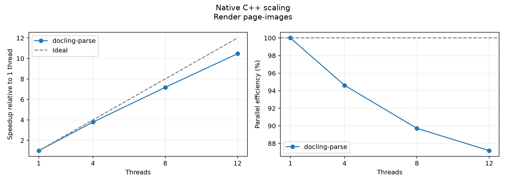

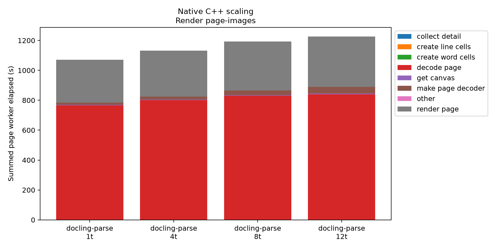

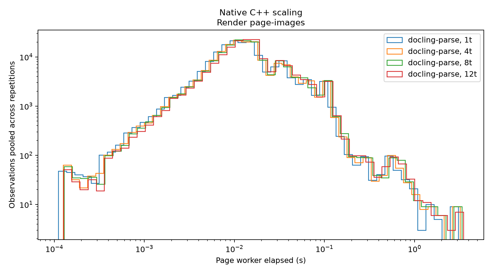

Stage totals sum overlapping worker elapsed time, not corpus wall or CPU time. Distributions describe native page-worker or replay document durations, not end-to-end page latency.

<details>
<summary>Reproduce these measurements</summary>

```bash
set -euo pipefail
PDF_ROOT=/Users/taa/.cache/huggingface/hub/datasets--docling-project--performance-dataset-bo767/snapshots/221c19e716d6ede5d18fd1560bc938ab19cc1a70/pdf
REPRO_OUT=$(mktemp -d "$PWD/scratch-performance-reproduce-XXXXXX")
observe() {
  local memory_output=$1; shift
  .venv/bin/python scripts/benchmarking/_performance_memory.py --memory-mode profile --memory-interval-ms 50 \
    --output "${memory_output}.memory.json" -- "$@"
}
for ((r=1; r<=3; r++)); do
  for t in 1 4 8 12; do
    observe "$REPRO_OUT/r${r}-t${t}" ./build/run_scaling.exe "$PDF_ROOT" -v WARNING --recursive --mode render \
      --threads "$t" --max-concurrent-results 32 --scale 1.0 \
      --create-word-cells=false --create-line-cells=false \
      --enable-timing --timing-csv "$REPRO_OUT/r${r}-t${t}.csv" \
      2>&1 | tee "$REPRO_OUT/r${r}-t${t}.log"
  done
done
```

</details>

### Render page-images and construct word/line text geometry

Timing: native wall_s; includes collection/CSV; excludes document preload.

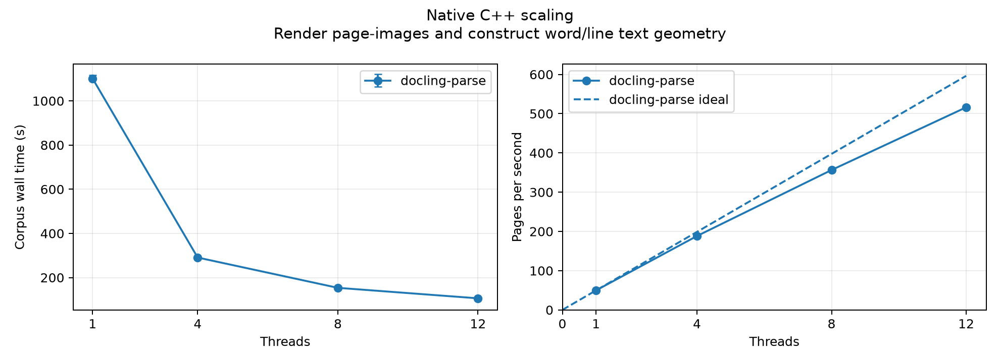

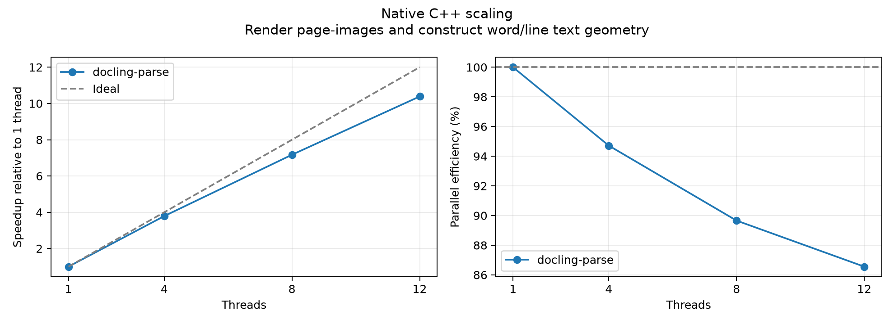

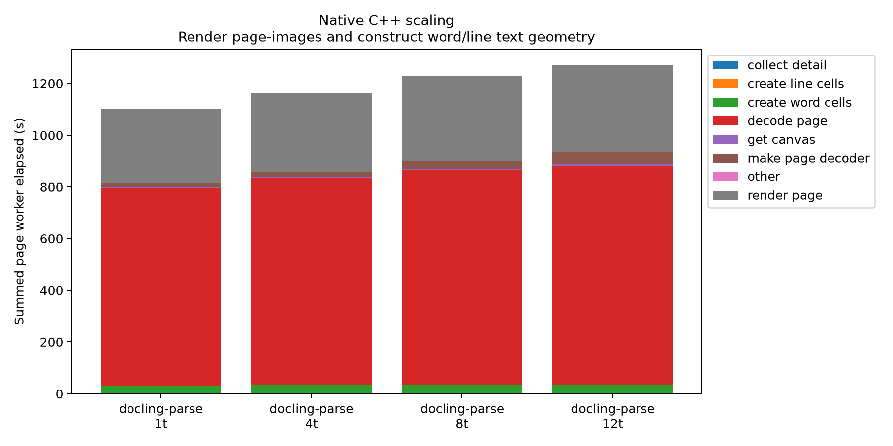

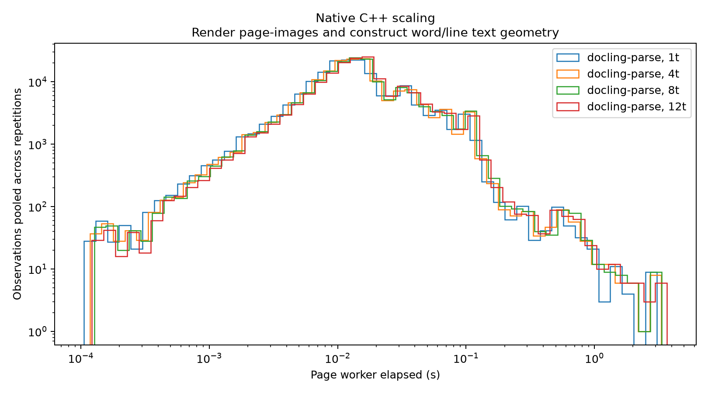

Stage totals sum overlapping worker elapsed time, not corpus wall or CPU time. Distributions describe native page-worker or replay document durations, not end-to-end page latency.

<details>
<summary>Reproduce these measurements</summary>

```bash
set -euo pipefail
PDF_ROOT=/Users/taa/.cache/huggingface/hub/datasets--docling-project--performance-dataset-bo767/snapshots/221c19e716d6ede5d18fd1560bc938ab19cc1a70/pdf
REPRO_OUT=$(mktemp -d "$PWD/scratch-performance-reproduce-XXXXXX")
observe() {
  local memory_output=$1; shift
  .venv/bin/python scripts/benchmarking/_performance_memory.py --memory-mode profile --memory-interval-ms 50 \
    --output "${memory_output}.memory.json" -- "$@"
}
for ((r=1; r<=3; r++)); do
  for t in 1 4 8 12; do
    observe "$REPRO_OUT/r${r}-t${t}" ./build/run_scaling.exe "$PDF_ROOT" -v WARNING --recursive --mode render \
      --threads "$t" --max-concurrent-results 32 --scale 1.0 \
      --create-word-cells=true --create-line-cells=true \
      --enable-timing --timing-csv "$REPRO_OUT/r${r}-t${t}.csv" \
      2>&1 | tee "$REPRO_OUT/r${r}-t${t}.log"
  done
done
```

</details>
<!-- performance:native:end -->

<!-- performance:replay:start -->
## Python scaling with Docling settings

| Backend       | Version   | Task   | Threads   | Runs   | Wall median (s)   | Min-max (s)       | Pages/s   | Speedup vs Docling 1t   | Efficiency   |
|---------------|-----------|--------|-----------|--------|-------------------|-------------------|-----------|-------------------------|--------------|
| pypdfium2     | 5.14.0    | render | 1         | 3      | 1457.800          | 1433.924-1491.756 | 37.5      | 0.79x                   | —            |
| docling-parse | 7.25.0    | render | 1         | 3      | 1154.735          | 1115.175-1160.067 | 47.4      | 1.00x                   | 100.0%       |
| docling-parse | 7.25.0    | render | 4         | 3      | 367.296           | 363.292-372.417   | 149.0     | 3.14x                   | 78.6%        |
| docling-parse | 7.25.0    | render | 8         | 3      | 279.370           | 274.860-285.899   | 195.9     | 4.13x                   | 51.7%        |
| docling-parse | 7.25.0    | render | 12        | 3      | 254.840           | 250.698-262.578   | 214.8     | 4.53x                   | 37.8%        |

### Page-images, word/line text geometry and bitmap bounding boxes

Timing: sum of document total_s; includes construction/load, processing and unload.

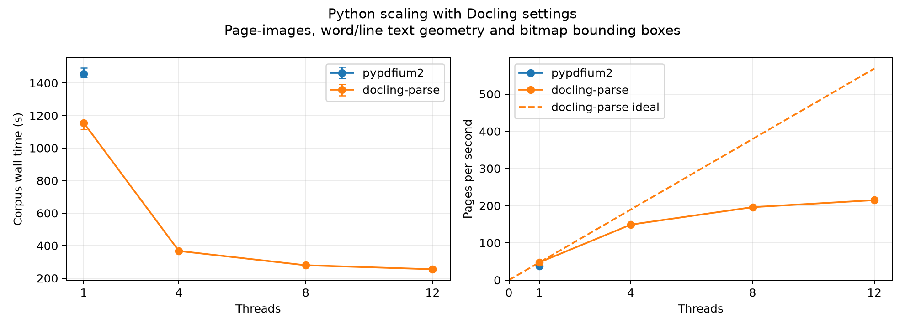

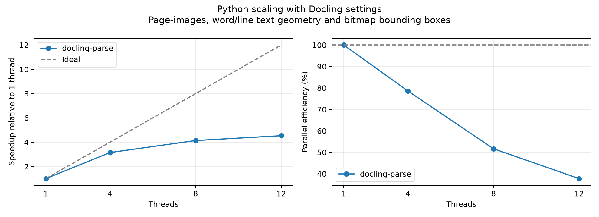

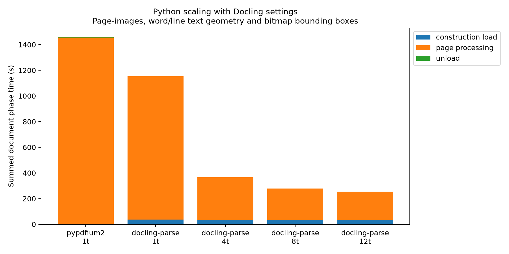

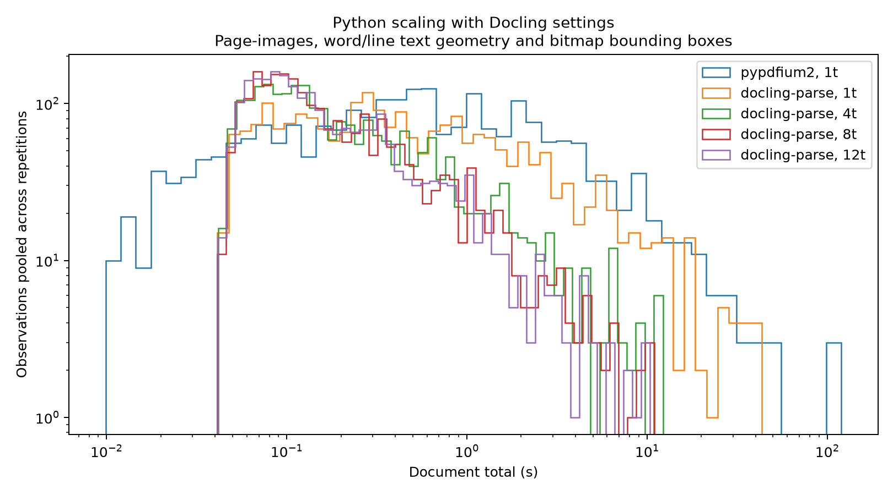

Stage totals sum overlapping worker elapsed time, not corpus wall or CPU time. Distributions describe native page-worker or replay document durations, not end-to-end page latency.

<details>
<summary>Reproduce these measurements</summary>

```bash
set -euo pipefail
PDF_ROOT=/Users/taa/.cache/huggingface/hub/datasets--docling-project--performance-dataset-bo767/snapshots/221c19e716d6ede5d18fd1560bc938ab19cc1a70/pdf
REPRO_OUT=$(mktemp -d "$PWD/scratch-performance-reproduce-XXXXXX")
observe() {
  local memory_output=$1; shift
  .venv/bin/python scripts/benchmarking/_performance_memory.py --memory-mode profile --memory-interval-ms 50 \
    --output "${memory_output}.memory.json" -- "$@"
}
for ((r=1; r<=3; r++)); do
  observe "$REPRO_OUT/r${r}-pdfium" .venv/bin/python scripts/benchmarking/run_performance_benchmarking_with_docling_settings.py "$PDF_ROOT" \
    --backend pdfium --dataset-revision 221c19e716d6ede5d18fd1560bc938ab19cc1a70 \
    --output-dir "$REPRO_OUT/r${r}-pdfium" 2>&1 | tee "$REPRO_OUT/r${r}-pdfium.log"
  for t in 1 4 8 12; do
    observe "$REPRO_OUT/r${r}-t${t}" .venv/bin/python scripts/benchmarking/run_performance_benchmarking_with_docling_settings.py "$PDF_ROOT" \
      --backend threaded --threads "$t" --dataset-revision 221c19e716d6ede5d18fd1560bc938ab19cc1a70 \
      --output-dir "$REPRO_OUT/r${r}-t${t}" 2>&1 | tee "$REPRO_OUT/r${r}-t${t}.log"
  done
done
```

</details>
<!-- performance:replay:end -->

<!-- performance:comparison:start -->
## Python cross-package comparison

Not collected in this run.
<!-- performance:comparison:end -->

<!-- performance:memory:start -->
## Process Memory

OS high-water marks cover one backend process and all its threads, including startup, loading and teardown. They exclude the monitor/logger and are not parser-only heap sizes. Timing retains each workload's existing boundaries. Missing observations are unavailable, never zero.

| Workload   | Backend       | Task             | Threads   | Peaks/runs   | Median MiB   | Min MiB   | Largest peak MiB   | Capture   |
|------------|---------------|------------------|-----------|--------------|--------------|-----------|--------------------|-----------|
| native     | docling-parse | render-only      | 1         | 3/3          | 11047.67     | 10996.17  | 11048.22           | profile   |
| native     | docling-parse | render-only      | 4         | 3/3          | 12448.70     | 12433.69  | 12538.94           | profile   |
| native     | docling-parse | render-only      | 8         | 3/3          | 13137.61     | 11913.42  | 13173.20           | profile   |
| native     | docling-parse | render-only      | 12        | 3/3          | 15219.81     | 14862.02  | 15619.06           | profile   |
| native     | docling-parse | render-with-text | 1         | 3/3          | 11102.88     | 11097.03  | 11168.17           | profile   |
| native     | docling-parse | render-with-text | 4         | 3/3          | 12396.61     | 11282.56  | 12540.33           | profile   |
| native     | docling-parse | render-with-text | 8         | 3/3          | 13168.28     | 13057.22  | 13186.28           | profile   |
| native     | docling-parse | render-with-text | 12        | 3/3          | 15343.41     | 14762.14  | 16298.81           | profile   |
| replay     | pdfium        | render           | 1         | 3/3          | 2520.64      | 2493.22   | 2540.17            | profile   |
| replay     | threaded      | render           | 1         | 3/3          | 4847.92      | 4842.22   | 4909.92            | profile   |
| replay     | threaded      | render           | 4         | 3/3          | 6641.08      | 6470.36   | 6647.22            | profile   |
| replay     | threaded      | render           | 8         | 3/3          | 6108.83      | 5931.45   | 6190.11            | profile   |
| replay     | threaded      | render           | 12        | 3/3          | 7120.94      | 7118.30   | 7212.56            | profile   |

`existing` denotes a previously recorded replay RUSAGE_SELF peak. Reused runs have no new timeline. Peak/profile comparison series run in fresh processes; memory-off comparisons retain their historical shared-process execution. Compare timing only under matching instrumentation and isolation. Sampled maxima are separate from OS peaks and can miss short spikes. Methods and scopes are recorded in publication provenance.


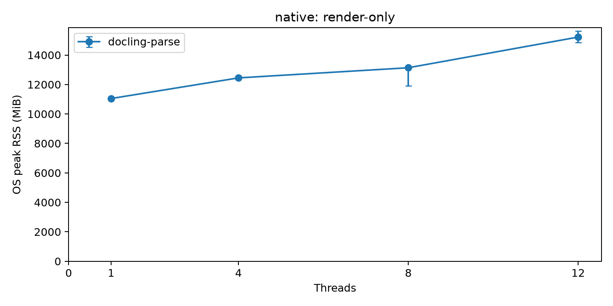

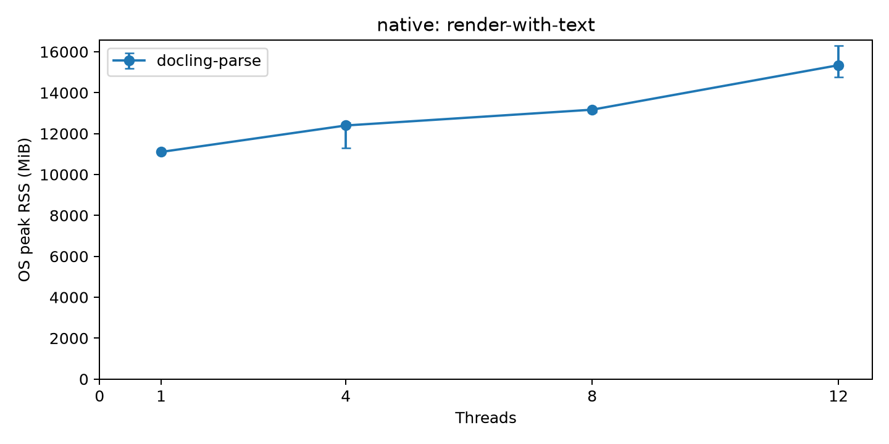

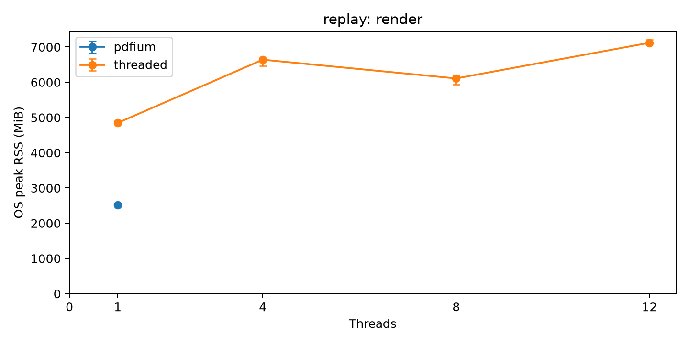
<!-- performance:memory:end -->

<!-- performance:provenance:start -->
## Provenance

[Dataset, source, build, packages and memory methods](provenance.json). Raw measurements and detailed RSS timelines remain in the local run bundle.
<!-- performance:provenance:end -->
