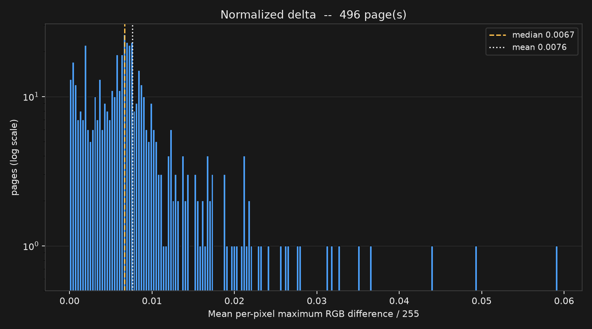
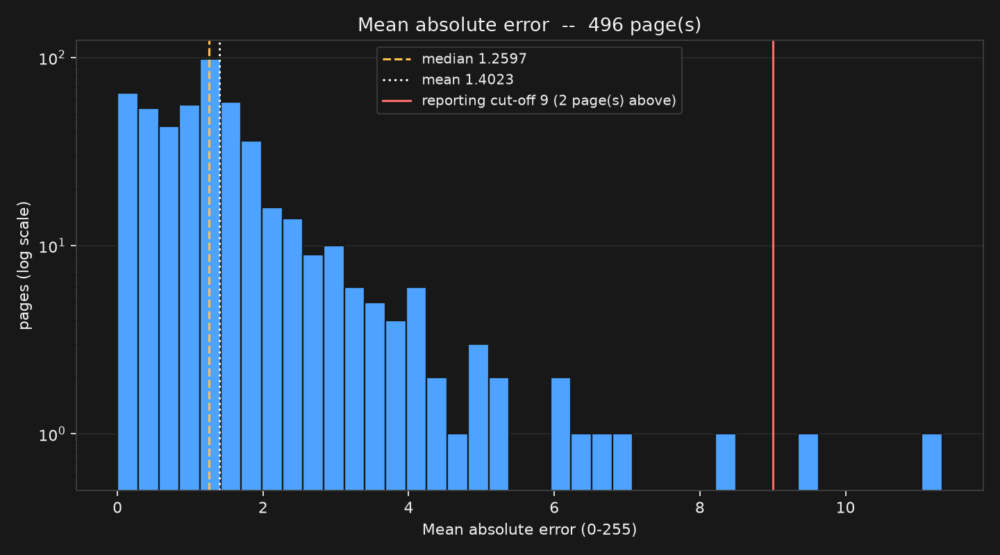
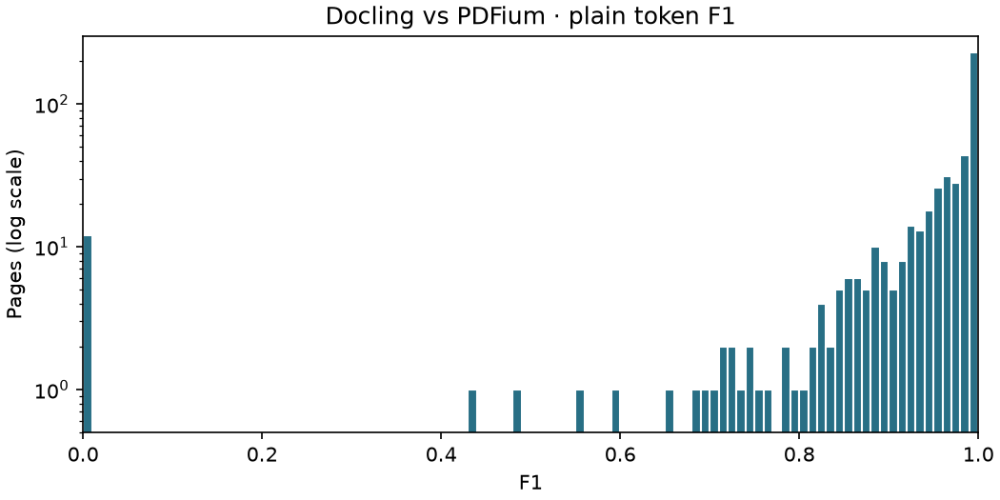
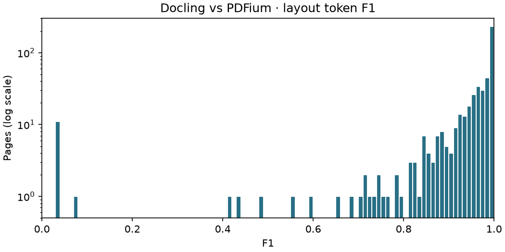
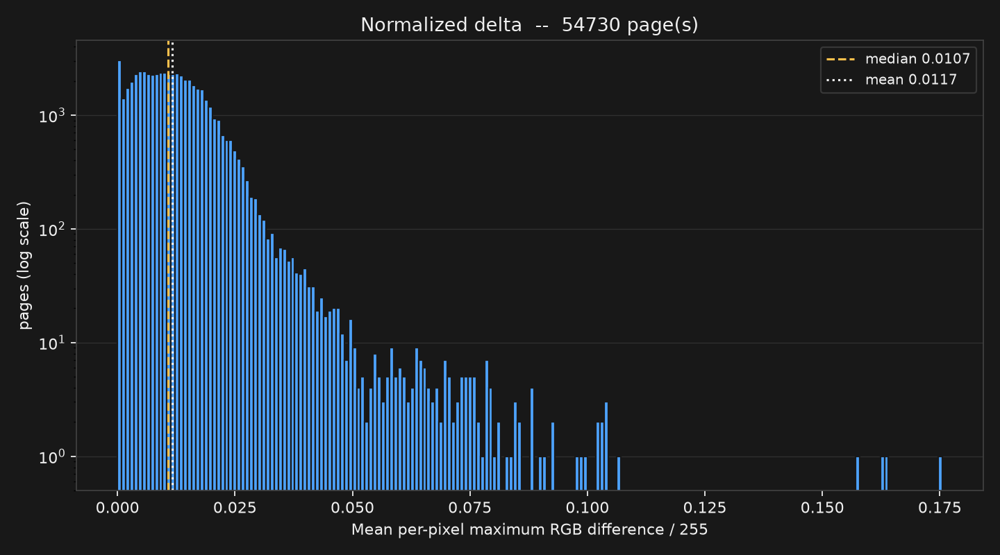
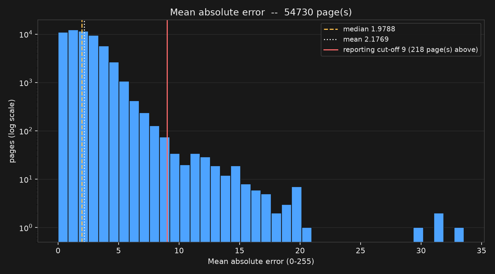
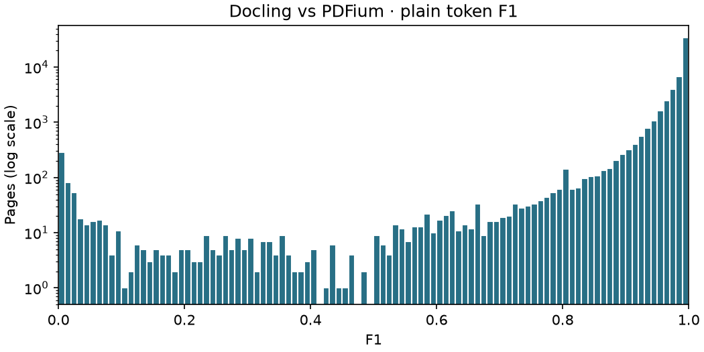
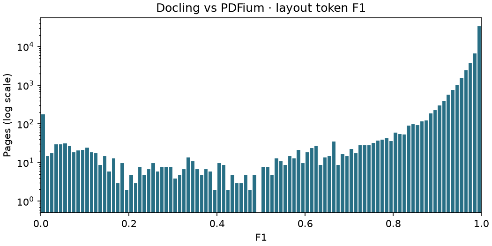

# Quality benchmarks

The quality benchmarks compare `docling-parse` with PDFium (via `pypdfium2`) on every page of two pinned datasets. BO20 contains 20 PDFs and 496 pages. BO767 contains 767 PDFs and 54,730 pages. The histograms show how closely the two implementations agree page by page.

## How quality is measured

### Rendering

Both renderers rasterize the same page at 2× (144 dpi) against a white background. If the image dimensions differ, the benchmark resizes the Docling image to the PDFium dimensions before comparing pixels and records the size mismatch separately.

- **Normalized pixel delta** takes the largest absolute difference among the red, green, and blue channels at each pixel, averages over the page, and divides by 255. A score of 0 means the images match at the comparison size. The maximum is 1.
- **Mean absolute error** averages absolute differences across all pixels and channels on the original 0–255 scale. Both images are opaque, so the alpha channel contributes zero difference.

Lower values indicate closer agreement with PDFium on both rendering metrics.

### Text extraction

Docling's `PdfEditor` extracts plain text and fixed-width layout text. The PDFium reference uses its page text for plain mode and reconstructs layout from glyph positions for layout mode.

Both text histograms show **token F1** per page. The score compares sets of unique whitespace-delimited tokens after Unicode NFC normalization. A score of 1 means the sets match, including when both are empty. A score of 0 means the sets have no tokens in common. The detailed reports also show **position F1** for layout text, which matches tokens by their starting row and column as well as their text.

## BO20

### Rendering





### Text extraction





## BO767

### Rendering





### Text extraction





## Reproduce the results

From the repository root, run both phases with PDFium as the reference. Choose new directories for `--output-dir`.

```sh
sh ./scripts/benchmarking/refresh_quality_benchmarks.sh \
  --dataset bo20 --mode=both --scale 2 --text-backends pypdfium2 \
  --output-dir ./scratch-quality-bo20

sh ./scripts/benchmarking/refresh_quality_benchmarks.sh \
  --dataset bo767 --mode=both --scale 2 --text-backends pypdfium2 \
  --output-dir ./scratch-quality-bo767
```

Each directory contains a `report.md`, per-page CSVs, and a `publication/` folder with the documentation assets. The detailed reports record dataset revisions, the source commit, and package versions.

Publish the reports and histograms from completed runs without rendering or extracting text again. Substitute the paths to your saved runs if they differ from the examples.

```sh
sh ./scripts/benchmarking/refresh_quality_benchmarks.sh \
  --from-run ./scratch-quality-bo20 \
  --from-run ./scratch-quality-bo767 \
  --update-docs
```

Omit `--update-docs` to preview publication. See [the benchmarking guide](../scripts/benchmarking/README.md#quality-benchmarking) for more options.

## Detailed reports

<!-- quality-benchmark-results -->

[Latest bo767 quality benchmark results](./quality_benchmarks/bo767/index.md)

[Latest bo20 quality benchmark results](./quality_benchmarks/bo20/index.md)
